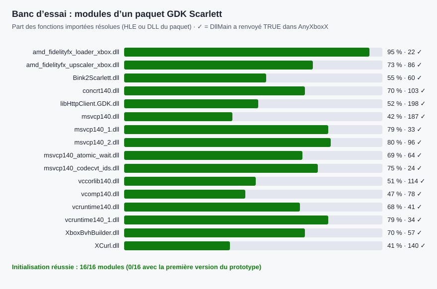

# Avancée et banc d'essai

Mesures du 21 novembre 2026. Pour les reproduire : `python PrototypeScarlett/scarlett.py --banc <dossier>`.

## Méthode

Le banc charge chaque module PE d'un dossier, lance ses callbacks TLS puis `DllMain(base, DLL_PROCESS_ATTACH, 0)`. Un module est **initialisé** quand `DllMain` renvoie `TRUE`. Le banc ne copie aucun fichier dans le dépôt : seuls les noms des modules et les mesures sont publiés.

Cas de test utilisés :

1. `PrototypeScarlett/demo.pe`, la démo libre du projet.
2. Les 16 DLL d'exécution d'un paquet GDK Scarlett du commerce présent sur la machine de développement. L'exécutable principal du jeu est absent du paquet : seul le démarrage des bibliothèques est testé.

## Résultats sur les 16 DLL

| Version | Modules chargés | `DllMain` réussi | Imports résolus | Appels non émulés |
|---|---|---|---|---|
| Première version (un seul import GDK accepté) | 0/16 | 0/16 | 1 fonction | — |
| Couche HLE, première passe | 16/16 | 4/16 | non mesuré | — |
| Ajout de `_initialize_onexit_table`, `IsProcessorFeaturePresent`, locale, maths | 16/16 | 16/16 | 523/1337 (39 %) | 7 |
| Plusieurs modules liés : chaque DLL charge ses dépendances du paquet | 16/16 | **16/16** | **782/1337 (58 %)** | **0** |

Un import est **résolu** quand il pointe vers une fonction émulée en Python ou vers l'export d'une autre DLL du paquet. Depuis le chargement multi-modules, `msvcp140.dll` tourne avec le vrai `vcruntime140.dll` du paquet, et `concrt140.dll` avec le vrai `msvcp140.dll`.

Fonctions qui ont débloqué le plus de modules :

| Fonction | Effet |
|---|---|
| `_initialize_onexit_table` | 12 DLL échouaient dans l'initialisation du CRT |
| `IsProcessorFeaturePresent` | 128 appels par passe : annonce SSE à SSE4.2 (le processeur émulé n'a pas AVX2) |
| `setlocale`, `__pctype_func`, `___lc_locale_name_func` | `msvcp140.dll` lisait un code d'erreur comme un pointeur |
| `exp`, `log`, `floor` (XMM0) | premières fonctions à argument flottant |

| `RtlPcToFileHeader`, `GetProcAddress`, `RegisterTraceGuidsW`, `___mb_cur_max_func` | derniers appels manquants des DLL liées |

Plus aucun appel non émulé pendant l'initialisation des 16 DLL. Les prochains manques apparaîtront quand le code du jeu lui-même s'exécutera.

## Chargement multi-modules

Ordre de résolution d'un import `dll!fonction` (`emu/modules.py`) :

1. DLL système (`kernel32`, `api-ms-win-*`, `xgameruntime`…) : toujours la couche HLE, même si un fichier du même nom est dans le paquet.
2. DLL présente dans le dossier du paquet : chargée comme module, l'import pointe vers son export. Les ordinaux et les redirections (`DLL.Fonction`) sont suivis.
3. Sinon : entrée HLE, ou `E_NOTIMPL` si la fonction n'est pas émulée.

Chaque module garde sa base préférée si elle est libre ; sinon il est relocalisé dans une zone dédiée (`0x6000_0000_0000`). Les dépendances sont initialisées avant le module qui les importe ; un `DllMain` qui renvoie `FALSE` annule le chargement, comme sous Windows.

## Limite connue

Une fonction absente renvoie `E_NOTIMPL` (`0x80004001`). C'est correct pour une fonction qui renvoie un `HRESULT`. Pour une fonction qui renvoie un `BOOL`, la valeur passe pour un succès ; pour un pointeur, elle provoque un accès mémoire invalide à `0x80004001`. Le journal nomme alors la fonction à émuler.

## Jeu libre pour les tests

Recherche faite le 21 novembre 2026 :

- Aucun jeu libre n'est publié sous forme de binaire Xbox Series X|S. Compiler pour `Gaming.Xbox.Scarlett.x64` exige le GDKX, réservé aux studios sous accord de confidentialité.
- **Candidat retenu** : un échantillon de [microsoft/Xbox-GDK-Samples](https://github.com/microsoft/Xbox-GDK-Samples) (licence MIT), par exemple `SystemInfo` ou `Gamepad`, compilé en `Gaming.Desktop.x64` avec le [GDK public](https://github.com/microsoft/GDK). Il importe `xgameruntime.dll` et utilise `MicrosoftGame.Config`, comme un titre Series X.
- **Alternative** : les programmes de test de [SDL](https://github.com/libsdl-org/SDL) (licence zlib), qui ont une cible GDK documentée dans [README-gdk.md](https://github.com/libsdl-org/SDL/blob/main/docs/README-gdk.md).

Prochaine étape (~1 h) : installer Visual Studio 2022 avec la charge C++ et le GDK public, compiler `SystemInfo` en x64, puis l'ajouter au banc.
