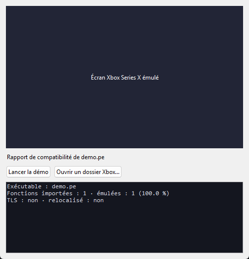

# AnyXboxX — Xbox-Series-X-Emulator (Prototyp)

[Français](../../README.md) · [English](README.en.md) · [Español](README.es.md) · **Deutsch** · [Italiano](README.it.md) · [Português](README.pt-BR.md) · [日本語](README.ja.md) · [中文](README.zh-CN.md)

AnyXboxX lädt Xbox-GDK-Programmdateien (Format PE32+ x86-64) und führt deren Code mit Unicorn aus. Die Systemfunktionen der Konsole werden durch Python-Code ersetzt (High-Level-Emulation, wie bei WinDurango oder Wine). Das Programm gibt sich als Xbox Series X aus: `XSystemGetDeviceType` liefert `XboxScarlettAnaconda` zurück.


## Projektfortschritt

| Schritt | Status |
|---|---|
| `MicrosoftGame.Config` einlesen (TitleId, Identität, Scarlett-Programmdatei) | ✅ erledigt |
| PE32+-Laden: Sektionen und Schutzattribute, Relokationen, Importe, Exporte | ✅ erledigt |
| TLS: Kopie der Vorlage, Index, Callbacks | ✅ erledigt |
| TEB und PEB über das GS-Register erreichbar | ✅ erledigt |
| HLE-Seite: 158 emulierte Funktionsnamen aus GDK, Kernel, CRT und Mathematik | ✅ erledigt |
| Unbekannte Funktionen: `E_NOTIMPL` und Protokolleintrag statt Ablehnung | ✅ erledigt |
| Globale C++-Konstruktoren (`_initterm`) als Gast-Code | ✅ erledigt |
| Kompatibilitätsbericht (`--rapport`) und Prüfstand (`--banc`) | ✅ erledigt |
| Mehrere verknüpfte Module in derselben Maschine: DLLs des Pakets, Ordinale, Weiterleitungen, Relokation bei Konflikten | ✅ erledigt |
| `GetModuleHandle`, `GetProcAddress`, `LoadLibrary`, `RtlPcToFileHeader` | ✅ erledigt |
| 16/16 DLLs eines Scarlett-Pakets samt Abhängigkeiten initialisiert, 0 nicht emulierte Aufrufe | ✅ erledigt |
| Freies Testspiel `SimpleTriangle` kompiliert: C-Start und GDK-Initialisierung laufen in AnyXboxX | ✅ erledigt |
| 74 automatisierte Tests, 83 % Abdeckung | ✅ erledigt |
| Win32-Fenster (`USER32`) und DirectX 12 (`d3d12`, `dxgi`) zur Anzeige des Dreiecks | ⏳ offen |
| Native Ausführung des Codes (Wine-Ansatz) statt Unicorn | ⏳ offen |
| x64-SEH-Ausnahmen (`.pdata`), mehrere Threads | ⏳ offen |
| Dynamisches Laden einer DLL zur Laufzeit (`LoadLibrary` + `DllMain`) | ⏳ offen |
| D3D12.X-Grafik nach Direct3D 12 / Vulkan | ⏳ offen |
| Audio, Controller, `XGameSave`-Spielstände | ⏳ offen |

<table>
<tr>
<td></td>
<td></td>
</tr>
<tr>
<td align="center">Die Demo reagiert auf die Pfeiltasten der Tastatur.</td>
<td align="center">Das Protokoll zeigt den Kompatibilitätsbericht an.</td>
</tr>
</table>

## Die Demo ausprobieren

Installiere unter Windows 64-Bit-Python 3.12 mit Tcl/Tk und öffne dann PowerShell im Stammverzeichnis des Repositorys.

```powershell
py -3.12 -m venv .venv
.\.venv\Scripts\python.exe -m pip install -r requirements.txt
.\.venv\Scripts\python.exe .\PrototypeScarlett\scarlett.py --demo
```

Das kompilierte Demoprogramm ist `PrototypeScarlett/demo.pe`; sein Quellcode ist `PrototypeScarlett/demo.c`.

## Ein Programm analysieren

```powershell
.\.venv\Scripts\python.exe .\PrototypeScarlett\scarlett.py --rapport <dossier ou fichier .exe>
```

Der Prüfstand lädt alle PE-Module eines Ordners und führt deren Initialisierung aus:

```powershell
.\.venv\Scripts\python.exe .\PrototypeScarlett\scarlett.py --banc <dossier>
```


Detaillierte Ergebnisse: [docs/avancee.md](../avancee.md) (auf Französisch). Freies Testspiel im Vergleich zu seiner nativen Ausführung: [docs/jeu-de-test.md](../jeu-de-test.md) (auf Französisch). Ein zusätzlicher DLL-Ordner (zum Beispiel die Visual-C++-DLLs) kann auf das Ziel folgen: `--rapport <cible> <dossier>`.

Der Bericht listet die importierten Funktionen, den bereits emulierten Anteil in Prozent und die fehlenden Funktionen auf. In der Oberfläche liest die Schaltfläche **Ouvrir un dossier Xbox…** (Xbox-Ordner öffnen) die Datei `MicrosoftGame.Config`, zeigt diesen Bericht an und startet dann das Programm; jeder nicht emulierte Aufruf erscheint im Protokoll.

## Architektur


| Modul | Aufgabe |
|---|---|
| `emu/config.py` | liest das Manifest des GDK-Pakets |
| `emu/loader.py` | lädt das PE-Image und bereitet Importe, Exporte und TLS vor |
| `emu/machine.py` | Unicorn-Prozessor, Stack, Heap, TEB/PEB, Verteilung der Aufrufe |
| `emu/hle/` | emulierte Funktionen: `gdk.py`, `kernel.py`, `crt.py`, `libm.py`, `guest.py` |
| `emu/report.py` | Kompatibilitätsbericht |
| `emu/modules.py` | lädt die DLLs des Pakets, bindet die Importe und ordnet die Initialisierungen |
| `emu/bench.py` | Prüfstand für einen Ordner mit Modulen |
| `scarlett.py` | Tkinter-Oberfläche und Kommandozeile |

Um eine Funktion hinzuzufügen, dekoriere einen Handler in `emu/hle/`:

```python
@hle("gdk")
def XSystemGetDeviceType(c):
    return XBOX_SERIES_X
```

## Recherche

- [Hardware-Architektur der Xbox Series X](../recherche/architecture-xbox-series-x.md) (auf Französisch): Zen-2-CPU, RDNA-2-GPU, Speicher, Velocity Architecture, Sicherheit.
- [Bestehende Emulatoren und Kompatibilitätsschichten](../recherche/etat-de-l-art.md) (auf Französisch): WinDurango, XWine1, Xenia, XVD-Werkzeuge.

## Tests

```powershell
.\.venv\Scripts\python.exe -m pip install -r requirements-dev.txt
.\.venv\Scripts\python.exe -m pytest
```

## Mitwirken

Der Branch `main` ist geschützt: Jeder Beitrag läuft über einen geprüften Pull Request, und die Tests müssen bestehen. Fehler und zu emulierende Funktionen werden in den Issues gemeldet. Die vollständigen Regeln stehen in [CONTRIBUTING.md](../../CONTRIBUTING.md) (auf Französisch).

## Einschränkungen

AnyXboxX ist ein Prototyp. Er führt keine kommerziellen Spiele aus: Diese benötigen die GPU der Konsole (D3D12.X) und zahlreiche Systemdienste und werden in verschlüsselten Containern ausgeliefert, deren Schlüssel in der Konsole verbleiben. Das Projekt enthält und akzeptiert keine geschützten Inhalte.
