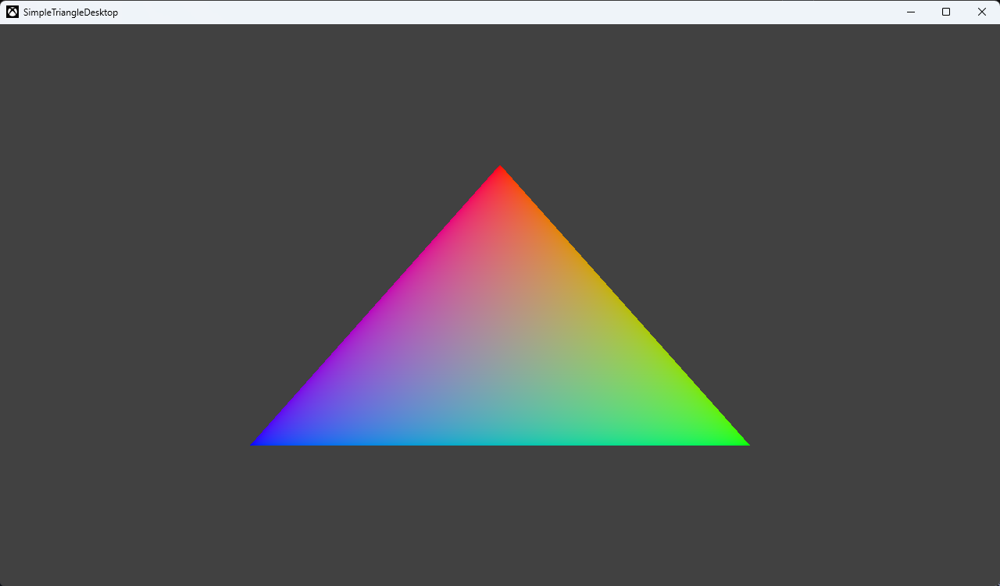
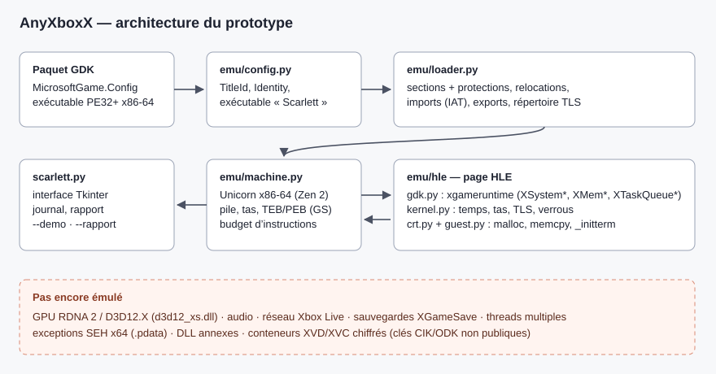

# AnyXboxX — Xbox Series X emulator (prototype)

[Français](../../README.md) · **English** · [Español](README.es.md) · [Deutsch](README.de.md) · [Italiano](README.it.md) · [Português](README.pt-BR.md) · [日本語](README.ja.md) · [中文](README.zh-CN.md)

AnyXboxX loads Xbox GDK executables (PE32+ x86-64 format) and runs their code with Unicorn. The console's system functions are replaced by Python code (high-level emulation, like WinDurango or Wine). The program presents itself as an Xbox Series X: `XSystemGetDeviceType` returns `XboxScarlettAnaconda`.


## Project progress

| Step | Status |
|---|---|
| Reading `MicrosoftGame.Config` (TitleId, identity, Scarlett executable) | ✅ done |
| PE32+ loading: sections and protections, relocations, imports, exports | ✅ done |
| TLS: template copy, index, callbacks | ✅ done |
| TEB and PEB reachable through the GS register | ✅ done |
| HLE page: 158 emulated GDK, kernel, CRT and math function names | ✅ done |
| Unknown functions: `E_NOTIMPL` and a log entry instead of a refusal | ✅ done |
| Global C++ constructors (`_initterm`) run as guest code | ✅ done |
| Compatibility report (`--rapport`) and test bench (`--banc`) | ✅ done |
| Several linked modules in a single machine: package DLLs, ordinals, forwarders, relocation on conflict | ✅ done |
| `GetModuleHandle`, `GetProcAddress`, `LoadLibrary`, `RtlPcToFileHeader` | ✅ done |
| 16/16 DLLs of a Scarlett package initialized with their dependencies, 0 non-emulated calls | ✅ done |
| Free `SimpleTriangle` test game compiled: C startup and GDK initialization run in AnyXboxX | ✅ done |
| Wine-style native execution (`--natif`): **SimpleTriangle is displayed**, GDK runtime served by AnyXboxX | ✅ done |
| 79 automated tests, 83% coverage | ✅ done |
| Translation of D3D12.X (`d3d12_xs.dll`) and `kernelx.dll` for console binaries | ⏳ to do |
| GDK runtime interfaces behind `QueryApiImpl` (`XUser`, `XTaskQueue`…) | ⏳ to do |
| x64 SEH exceptions (`.pdata`), multiple threads | ⏳ to do |
| Dynamic loading of a DLL at run time (`LoadLibrary` + `DllMain`) | ⏳ to do |
| D3D12.X graphics to Direct3D 12 / Vulkan | ⏳ to do |
| Audio, controller, `XGameSave` saves | ⏳ to do |

<table>
<tr>
<td></td>
<td></td>
</tr>
<tr>
<td align="center">The demo responds to the keyboard arrow keys.</td>
<td align="center">The log shows the compatibility report.</td>
</tr>
</table>

## Try the demo

On Windows, install 64-bit Python 3.12 with Tcl/Tk, then open PowerShell at the root of the repository.

```powershell
py -3.12 -m venv .venv
.\.venv\Scripts\python.exe -m pip install -r requirements.txt
.\.venv\Scripts\python.exe .\PrototypeScarlett\scarlett.py --demo
```

The compiled demo program is `PrototypeScarlett/demo.pe`; its source code is `PrototypeScarlett/demo.c`.

## Run a game in native mode

```powershell
.\.venv\Scripts\python.exe .\PrototypeScarlett\scarlett.py --natif <dossier ou fichier .exe> [dossiers de DLL…]
```



AnyXboxX loads the executable itself and runs it directly on the processor, like Wine. The Xbox runtime (`xgameruntime.dll`) is provided by AnyXboxX; the window and DirectX 12 are the PC's. **Warning: in native mode, the program is not isolated.** Reserve this mode for trusted programs; `--rapport` and `--banc` remain isolated inside Unicorn. `ANYXBOXX_TRACE=1` displays the intercepted calls. Details: [docs/jeu-de-test.md](../jeu-de-test.md) (in French).

## Analyze a program

```powershell
.\.venv\Scripts\python.exe .\PrototypeScarlett\scarlett.py --rapport <dossier ou fichier .exe>
```

The test bench loads every PE module in a folder and runs their initialization:

```powershell
.\.venv\Scripts\python.exe .\PrototypeScarlett\scarlett.py --banc <dossier>
```


Detailed results: [docs/avancee.md](../avancee.md) (in French). Free test game compared with its native execution: [docs/jeu-de-test.md](../jeu-de-test.md) (in French). An additional DLL folder (for example the Visual C++ DLLs) can follow the target: `--rapport <cible> <dossier>`.

The report lists the imported functions, the percentage already emulated and the missing functions. In the interface, the **Ouvrir un dossier Xbox…** (Open an Xbox folder) button reads `MicrosoftGame.Config`, displays this report, then launches the program; every non-emulated call appears in the log.

## Architecture



| Module | Role |
|---|---|
| `emu/config.py` | reads the GDK package manifest |
| `emu/loader.py` | loads the PE image and prepares imports, exports and TLS |
| `emu/machine.py` | Unicorn processor, stack, heap, TEB/PEB, call dispatch |
| `emu/hle/` | emulated functions: `gdk.py`, `kernel.py`, `crt.py`, `libm.py`, `guest.py` |
| `emu/report.py` | compatibility report |
| `emu/modules.py` | loads the package DLLs, links the imports, orders the initializations |
| `emu/bench.py` | test bench on a folder of modules |
| `emu/native/` | Wine-style native execution: loader, real imports, AnyXboxX's GDK runtime |
| `scarlett.py` | Tkinter interface and command line |

To add a function, decorate a handler in `emu/hle/`:

```python
@hle("gdk")
def XSystemGetDeviceType(c):
    return XBOX_SERIES_X
```

## Research

- [Xbox Series X hardware architecture](../recherche/architecture-xbox-series-x.md) (in French): Zen 2 CPU, RDNA 2 GPU, memory, Velocity Architecture, security.
- [Existing emulators and compatibility layers](../recherche/etat-de-l-art.md) (in French): WinDurango, XWine1, Xenia, XVD tools.

## Tests

```powershell
.\.venv\Scripts\python.exe -m pip install -r requirements-dev.txt
.\.venv\Scripts\python.exe -m pytest
```

## Contributing

The `main` branch is protected: every contribution goes through a reviewed pull request, and the tests must pass. Bugs and functions to emulate are reported in the issues. The full rules are in [CONTRIBUTING.md](../../CONTRIBUTING.md) (in French).

## Limitations

AnyXboxX is a prototype. It does not run commercial games: they require the console's GPU (D3D12.X) and many system services, and they ship in encrypted containers whose keys stay inside the console. The project contains and accepts no protected content.
