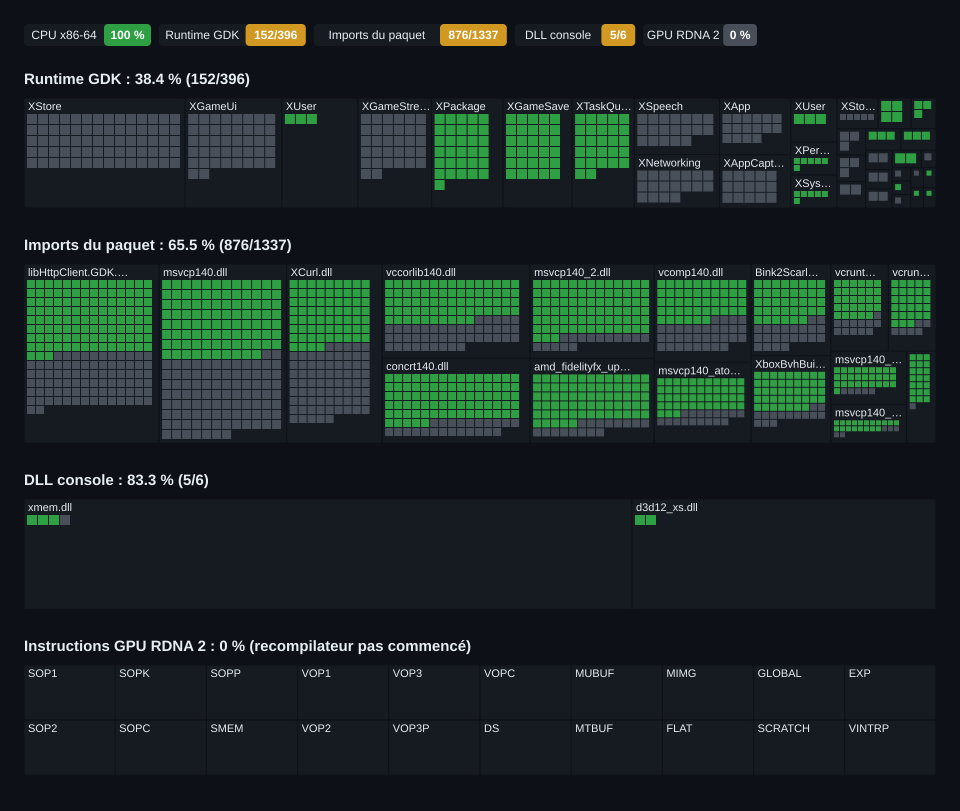
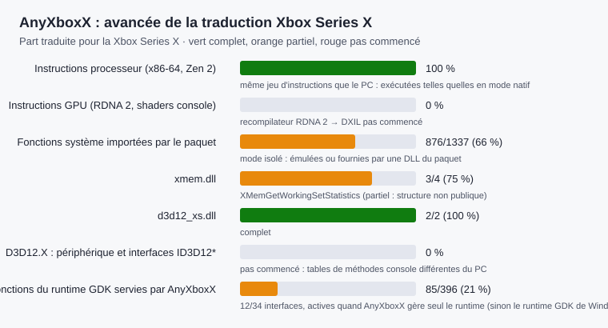

# AnyXboxX — emulador de Xbox Series X (prototipo)

[Français](../../README.md) · [English](README.en.md) · **Español** · [Deutsch](README.de.md) · [Italiano](README.it.md) · [Português](README.pt-BR.md) · [日本語](README.ja.md) · [中文](README.zh-CN.md)

AnyXboxX carga ejecutables de Xbox GDK (formato PE32+ x86-64) y ejecuta su código con Unicorn. Las funciones de sistema de la consola se sustituyen por un runtime C++ en modo nativo, y por código Python en la máquina aislada (emulación de alto nivel, como WinDurango o Wine). El programa se presenta como una Xbox Series X: `XSystemGetDeviceType` devuelve `XboxScarlettAnaconda`.


## Avance de la traducción



Regenerar: `scarlett.py --carte <carpeta del paquete> docs/images/carte-avancee.svg`.



- **Instrucciones del procesador: 100 %.** La Series X usa un AMD Zen 2 en x86-64, el mismo conjunto de instrucciones que un PC: en modo nativo, el código del juego se ejecuta tal cual, sin traducción.
- **Instrucciones de la GPU: 0 %.** Los shaders de un juego de consola se compilan para la GPU RDNA 2 de la Series X. Hace falta un recompilador RDNA 2 → DXIL, aún sin empezar.
- **Funciones de sistema: 66 %** de las 1 337 funciones importadas por las DLL del paquete de prueba se resuelven en modo aislado.
- **DLL propias de la consola**: `xmem.dll` (3/4) y `d3d12_xs.dll` (2/2) están traducidas para las funciones que usa el paquete. La creación del dispositivo D3D12.X queda por escribir.
- **Runtime GDK: 121 de las 396 funciones** están escritas en AnyXboxX, en C++: la cola de tareas (`XTaskQueue`, `XAsync`, `XThread`), el usuario (`XUser`, un perfil local sin conexión), la identidad de la Xbox Series X (`XSystem`, Title ID, analítica, funcionalidades del runtime) y las partidas guardadas (`XGameSave`, `XGameSaveFiles`, `XPersistentLocalStorage`). Se usan cuando AnyXboxX gestiona el runtime por sí solo: sin Gaming Services, o con `ANYXBOXX_SYSTEM_RUNTIME=0`. Si el runtime GDK de Windows está presente, sirve todas las interfaces, incluida la cola de tareas, porque sus API solo aceptan sus propias colas. La traza (`ANYXBOXX_TRACE=1`) nombra cada interfaz solicitada.

El gráfico se regenera con `scarlett.py --traduction <carpeta del paquete> docs/images/traduction.svg`.

## Avance del proyecto

| Etapa | Estado |
|---|---|
| Lectura de `MicrosoftGame.Config` (TitleId, identidad, ejecutable Scarlett) | ✅ hecho |
| Carga PE32+: secciones y protecciones, reubicaciones, importaciones, exportaciones | ✅ hecho |
| TLS: copia de la plantilla, índice, callbacks | ✅ hecho |
| TEB y PEB accesibles mediante el registro GS | ✅ hecho |
| Página HLE: 158 nombres de funciones GDK, kernel, CRT y matemáticas emulados | ✅ hecho |
| Funciones desconocidas: `E_NOTIMPL` y registro en el diario en lugar de un rechazo | ✅ hecho |
| Constructores globales de C++ (`_initterm`) ejecutados como código invitado | ✅ hecho |
| Informe de compatibilidad (`--rapport`) y banco de pruebas (`--banc`) | ✅ hecho |
| Varios módulos enlazados en una misma máquina: DLL del paquete, ordinales, redirecciones, reubicación en caso de conflicto | ✅ hecho |
| `GetModuleHandle`, `GetProcAddress`, `LoadLibrary`, `RtlPcToFileHeader` | ✅ hecho |
| 16/16 DLL de un paquete Scarlett inicializadas con sus dependencias, 0 llamadas no emuladas | ✅ hecho |
| Juego de prueba libre `SimpleTriangle` compilado: el arranque en C y la inicialización de GDK funcionan en AnyXboxX | ✅ hecho |
| Ejecución nativa al estilo Wine (`--natif`): **SimpleTriangle se muestra**, runtime GDK proporcionado por AnyXboxX | ✅ hecho |
| Segundo juego de prueba libre, `testgdk` de SDL3: **funciona en modo nativo** (ventana, sprites, sonido) | ✅ hecho |
| Lanzamiento aislado de un paquete o de un exe (`--lancer`) con la lista de llamadas por emular | ✅ hecho |
| Runtime C++ (`runtime/`): `xgameruntime.dll`, `xmem.dll`, `d3d12_xs.dll` precargadas en modo nativo, servidas a todas las DLL del juego | ✅ hecho |
| `xmem.dll`: `XMemAlloc`, `XMemFree`, ganchos, `XMemVirtualQuery` | ✅ hecho |
| `d3d12_xs.dll`: serialización de las firmas raíz, redirigida al D3D12 del PC | ✅ hecho |
| Tabla de las 396 funciones GDK: interfaz y número de método, extraídos de `xgameruntime.lib` (`tools/gdk_interfaces.py`) | ✅ hecho |
| `XTaskQueue`, `XAsync`, `XThread` servidas por AnyXboxX: testgdk funciona sin el runtime de Windows | ✅ hecho |
| Otras interfaces GDK: delegadas al runtime GDK de Windows, nombradas por la traza | 🟡 en curso |
| 149 pruebas automatizadas | ✅ hecho |
| D3D12.X: `D3D12XboxCreateDevice` e interfaces `ID3D12*` de la consola | ⏳ pendiente |
| `XUser` sin conexión: perfil local siempre conectado, gamertag configurable (`ANYXBOXX_GAMERTAG`), inicio de sesión de testgdk correcto | ✅ hecho |
| Identidad de la Xbox Series X: tipo de consola (valor de registro `ConsoleMode` simulado, también dentro de las DLL del juego), `XSystem`, Title ID leído de `MicrosoftGame.config`, analítica «Xbox Series X» | ✅ hecho |
| Mapa del avance: una casilla por función (`--carte`) | ✅ hecho |
| Partidas guardadas `XGameSave` (contenedores, blobs, cuota, lectura asíncrona) y almacenamiento local persistente, en el disco del PC (`%LOCALAPPDATA%\AnyXboxX\<TitleId>`, o `ANYXBOXX_SAVE_DIR`) | ✅ hecho |
| Otras interfaces GDK escritas por AnyXboxX (`XPackage`, `XStore`, `XGameUi`…) | ⏳ pendiente |
| Recompilador de shaders RDNA 2 → DXIL | ⏳ pendiente |
| Excepciones SEH x64 (`.pdata`), múltiples hilos | ⏳ pendiente |
| Carga dinámica de una DLL durante la ejecución (`LoadLibrary` + `DllMain`) | ⏳ pendiente |
| Gráficos D3D12.X hacia Direct3D 12 / Vulkan | ⏳ pendiente |
| Audio, mando, partidas guardadas `XGameSave` | ⏳ pendiente |

<table>
<tr>
<td></td>
<td></td>
</tr>
<tr>
<td align="center">La demo responde a las flechas del teclado.</td>
<td align="center">El diario muestra el informe de compatibilidad.</td>
</tr>
</table>

## Probar la demo

En Windows, instala Python 3.12 de 64 bits con Tcl/Tk y abre PowerShell en la raíz del repositorio.

```powershell
py -3.12 -m venv .venv
.\.venv\Scripts\python.exe -m pip install -r requirements.txt
.\.venv\Scripts\python.exe .\PrototypeScarlett\scarlett.py --demo
```

El modo nativo necesita el runtime C++. Se compila con Visual Studio 2022 o 2026 (carga de trabajo de C++) y CMake:

```powershell
cmake -S runtime -B runtime/build -A x64
cmake --build runtime/build --config Release
```

La cola de tareas reutiliza el módulo `Task` de [libHttpClient](https://github.com/microsoft/libHttpClient) (licencia MIT, `runtime/third_party/libhttpclient-task`). Las DLL acaban en `runtime/build/bin`, o en la carpeta indicada por `ANYXBOXX_RUNTIME`. `ANYXBOXX_SYSTEM_RUNTIME=0` desactiva la delegación al runtime GDK de Windows.

El programa de demostración compilado es `PrototypeScarlett/demo.pe`; su código fuente es `PrototypeScarlett/demo.c`.

## Lanzar un juego en modo nativo

```powershell
.\.venv\Scripts\python.exe .\PrototypeScarlett\scarlett.py --natif <dossier ou fichier .exe> [dossiers de DLL…]
```


AnyXboxX carga el propio ejecutable y lo ejecuta directamente en el procesador, como Wine. El runtime de Xbox (`xgameruntime.dll`) lo proporciona AnyXboxX; la ventana y DirectX 12 son los del PC. **Atención: en modo nativo, el programa no está aislado.** Reserva este modo para programas de confianza; `--rapport` y `--banc` siguen aislados dentro de Unicorn. `ANYXBOXX_TRACE=1` muestra las llamadas interceptadas. Detalles: [docs/jeu-de-test.md](../jeu-de-test.md) (en francés).

## Lanzar un paquete en modo aislado

```powershell
.\.venv\Scripts\python.exe .\PrototypeScarlett\scarlett.py --lancer <dossier du paquet ou fichier .exe> [dossiers de DLL…]
```

Con una carpeta, AnyXboxX lee `MicrosoftGame.Config`, toma el ejecutable declarado para `Scarlett` y lo lanza en la máquina aislada (Unicorn): el programa no toca el PC. El informe indica las importaciones sin resolver y después las llamadas no emuladas, de la más frecuente a la más rara: es la lista de trabajo para completar el emulador. Si falta el ejecutable, el mensaje lo nombra.

## Analizar un programa

```powershell
.\.venv\Scripts\python.exe .\PrototypeScarlett\scarlett.py --rapport <dossier ou fichier .exe>
```

El banco de pruebas carga todos los módulos PE de una carpeta y ejecuta su inicialización:

```powershell
.\.venv\Scripts\python.exe .\PrototypeScarlett\scarlett.py --banc <dossier>
```


Resultados detallados: [docs/avancee.md](../avancee.md) (en francés). Juego de prueba libre comparado con su ejecución nativa: [docs/jeu-de-test.md](../jeu-de-test.md) (en francés). Una carpeta de DLL adicional (por ejemplo, las DLL de Visual C++) puede seguir al objetivo: `--rapport <cible> <dossier>`.

El informe enumera las funciones importadas, el porcentaje ya emulado y las funciones que faltan. En la interfaz, el botón **Ouvrir un dossier Xbox…** (Abrir una carpeta Xbox) lee `MicrosoftGame.Config`, muestra este informe y luego lanza el programa; cada llamada no emulada aparece en el diario.

## Arquitectura


| Módulo | Función |
|---|---|
| `emu/config.py` | lee el manifiesto del paquete GDK |
| `emu/loader.py` | carga la imagen PE y prepara importaciones, exportaciones y TLS |
| `emu/machine.py` | procesador Unicorn, pila, heap, TEB/PEB, despacho de llamadas |
| `emu/hle/` | funciones emuladas: `gdk.py`, `kernel.py`, `crt.py`, `libm.py`, `guest.py` |
| `emu/report.py` | informe de compatibilidad |
| `emu/modules.py` | carga las DLL del paquete, enlaza las importaciones, ordena las inicializaciones |
| `emu/bench.py` | banco de pruebas sobre una carpeta de módulos |
| `emu/native/` | ejecución nativa al estilo Wine: cargador, importaciones reales, runtime GDK de AnyXboxX |
| `scarlett.py` | interfaz Tkinter y línea de comandos |

Para añadir una función, decora un manejador en `emu/hle/`:

```python
@hle("gdk")
def XSystemGetDeviceType(c):
    return XBOX_SERIES_X
```

## Investigación

- [Arquitectura de hardware de la Xbox Series X](../recherche/architecture-xbox-series-x.md) (en francés): CPU Zen 2, GPU RDNA 2, memoria, Velocity Architecture, seguridad.
- [Emuladores y capas de compatibilidad existentes](../recherche/etat-de-l-art.md) (en francés): WinDurango, XWine1, Xenia, herramientas XVD.

## Pruebas

```powershell
.\.venv\Scripts\python.exe -m pip install -r requirements-dev.txt
.\.venv\Scripts\python.exe -m pytest
```

## Contribuir

La rama `main` está protegida: toda contribución pasa por una pull request revisada, y las pruebas deben pasar. Los errores y las funciones por emular se notifican en las issues. Las reglas completas están en [CONTRIBUTING.md](../../CONTRIBUTING.md) (en francés).

## Límites

AnyXboxX es un prototipo. No ejecuta juegos comerciales: exigen la GPU de la consola (D3D12.X) y numerosos servicios del sistema, y se distribuyen en contenedores cifrados cuyas claves permanecen dentro de la consola. El proyecto no contiene ni acepta ningún contenido protegido.
