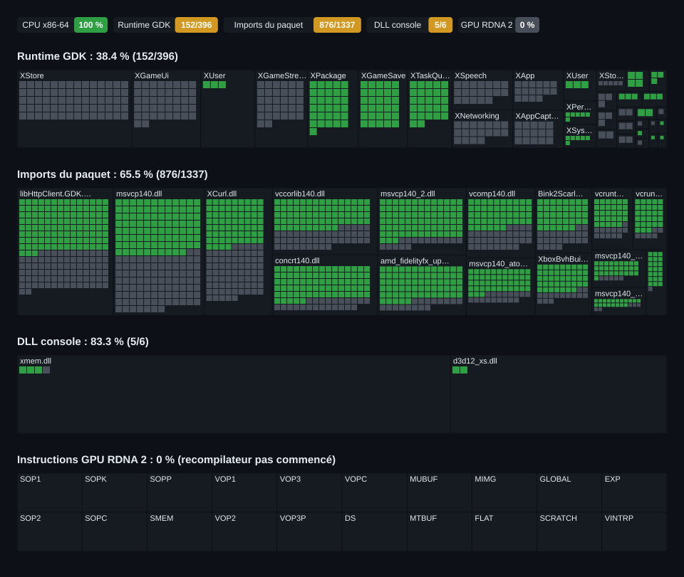
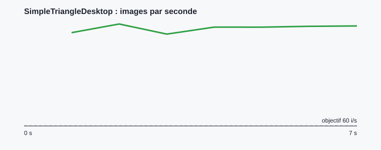
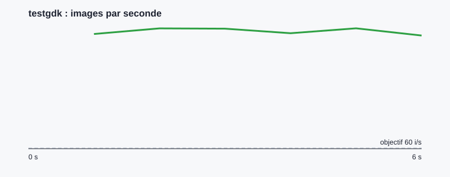

# AnyXboxX — émulateur Xbox Series X (prototype)

[English](../../README.md) · **Français** · [Español](README.es.md) · [Deutsch](README.de.md) · [Italiano](README.it.md) · [Português](README.pt-BR.md) · [日本語](README.ja.md) · [中文](README.zh-CN.md)

AnyXboxX charge des exécutables Xbox GDK (format PE32+ x86-64) et exécute leur code avec Unicorn. Les fonctions système de la console sont remplacées par un runtime C++ en mode natif, et par du code Python dans la machine isolée (émulation de haut niveau, comme WinDurango ou Wine). Le programme se présente comme une Xbox Series X : `XSystemGetDeviceType` renvoie `XboxScarlettAnaconda`.

Pour poursuivre l'analyse du paquet Scarlett étudié, voir le [plan de compatibilité et ses limites](../recherche/plan-compatibilite-paquet.md).

## Avancée de la traduction



Régénérer : `scarlett.py --carte <dossier du paquet> docs/images/carte-avancee.svg`.


- **Instructions processeur : 100 %.** La Series X utilise un AMD Zen 2 en x86-64, le même jeu d'instructions qu'un PC : en mode natif, le code du jeu s'exécute tel quel, sans traduction.
- **Instructions GPU : 0 %.** Les shaders d'un jeu console sont compilés pour le GPU RDNA 2 de la Series X. Il faut un recompilateur RDNA 2 → DXIL, pas encore commencé.
- **Fonctions système : 66 %** des 1 337 fonctions importées par les DLL du paquet de test sont résolues en mode isolé.
- **DLL propres à la console** : `xmem.dll` (3/4) et `d3d12_xs.dll` (2/2) sont traduites pour les fonctions que le paquet utilise. La création du périphérique D3D12.X reste à écrire.
- **Runtime GDK : 152 des 396 fonctions** sont écrites dans AnyXboxX, en C++ : la file de tâches (`XTaskQueue`, `XAsync`, `XThread`), l'utilisateur (`XUser`, un profil local hors ligne) l'identité Xbox Series X (`XSystem`, Title ID, analytique, fonctionnalités du runtime) les sauvegardes (`XGameSave`, `XGameSaveFiles`, `XPersistentLocalStorage`) et le paquet du jeu (`XPackage`). Elles servent quand AnyXboxX gère seul le runtime : sans Gaming Services, ou avec `ANYXBOXX_SYSTEM_RUNTIME=0`. Si le runtime GDK de Windows est présent, il sert toutes les interfaces, file de tâches comprise, car ses API n'acceptent que ses propres files. La trace (`ANYXBOXX_TRACE=1`) nomme chaque interface demandée.

Le graphique est régénéré par `scarlett.py --traduction <dossier du paquet> docs/images/traduction.svg`.

## Performance (objectif : 60 images par seconde constantes)

```powershell
.\.venv\Scripts\python.exe .\PrototypeScarlett\scarlett.py --banc-perf <jeu.exe> [secondes] [courbe.svg]
.\.venv\Scripts\python.exe .\PrototypeScarlett\scarlett.py --natif <jeu.exe> --fps
```

Le runtime C++ chronomètre chaque `Present` de la swap chain DXGI du jeu, y compris quand DXGI est chargé dynamiquement par une DLL du jeu (SDL3). Il en tire les images par seconde, le temps moyen d'une image et le « 1 % bas » (cadence des 1 % d'images les plus lentes, qui révèle les saccades). `--fps` affiche ces valeurs dans le titre de la fenêtre. `--banc-perf` mesure pendant N secondes, sans compter la première (chargement), et rend un verdict « 60 i/s constants » (code de retour 2 si l'objectif est manqué). Sans ces options, rien n'est intercepté.





Les deux jeux de test tournent sans synchronisation verticale : environ 11 700 i/s pour SimpleTriangle et 12 600 i/s pour testgdk, en mode natif.

## Avancée du projet

| Étape | État |
|---|---|
| Lecture de `MicrosoftGame.Config` (TitleId, identité, exécutable Scarlett) | ✅ fait |
| Chargement PE32+ : sections et protections, relocations, imports, exports | ✅ fait |
| TLS : copie du modèle, index, callbacks | ✅ fait |
| TEB et PEB accessibles par le registre GS | ✅ fait |
| Page HLE : 158 noms de fonctions GDK, kernel, CRT et maths émulés | ✅ fait |
| Fonctions inconnues : `E_NOTIMPL` et journal au lieu d'un refus | ✅ fait |
| Constructeurs C++ globaux (`_initterm`) en code invité | ✅ fait |
| Rapport de compatibilité (`--rapport`) et banc d'essai (`--banc`) | ✅ fait |
| Plusieurs modules liés dans une même machine : DLL du paquet, ordinaux, redirections, relocation en cas de conflit | ✅ fait |
| `GetModuleHandle`, `GetProcAddress`, `LoadLibrary`, `RtlPcToFileHeader` | ✅ fait |
| 16/16 DLL d'un paquet Scarlett initialisées avec leurs dépendances, 0 appel non émulé | ✅ fait |
| Jeu de test libre `SimpleTriangle` compilé : démarrage C et initialisation GDK passent dans AnyXboxX | ✅ fait |
| Exécution native façon Wine (`--natif`) : **SimpleTriangle s'affiche**, runtime GDK servi par AnyXboxX | ✅ fait |
| Deuxième jeu de test libre, `testgdk` de SDL3 : **tourne en mode natif** (fenêtre, sprites, son) | ✅ fait |
| Lancement isolé d'un paquet ou d'un exe (`--lancer`) avec la liste des appels à émuler | ✅ fait |
| Runtime C++ (`runtime/`) : `xgameruntime.dll`, `xmem.dll`, `d3d12_xs.dll` préchargées en mode natif, servies à toutes les DLL du jeu | ✅ fait |
| `xmem.dll` : `XMemAlloc`, `XMemFree`, crochets, `XMemVirtualQuery` | ✅ fait |
| `d3d12_xs.dll` : sérialisation des signatures racine, redirigée vers le D3D12 du PC | ✅ fait |
| Table des 396 fonctions GDK : interface et n° de méthode, extraits de `xgameruntime.lib` (`tools/gdk_interfaces.py`) | ✅ fait |
| `XTaskQueue`, `XAsync`, `XThread` servies par AnyXboxX : testgdk tourne sans le runtime de Windows | ✅ fait |
| Autres interfaces GDK : déléguées au runtime GDK de Windows, nommées par la trace | 🟡 en cours |
| 180 tests automatisés | ✅ fait |
| D3D12.X : `D3D12XboxCreateDevice` et interfaces `ID3D12*` de la console | ⏳ à faire |
| `XUser` hors ligne : profil local toujours connecté, gamertag réglable (`ANYXBOXX_GAMERTAG`), connexion de testgdk réussie | ✅ fait |
| Identité Xbox Series X : type de console (registre `ConsoleMode` simulé, y compris dans les DLL du jeu), `XSystem`, Title ID lu dans `MicrosoftGame.config`, analytique « Xbox Series X » | ✅ fait |
| Carte d'avancée : une case par fonction (`--carte`) | ✅ fait |
| Manette (`GameInput`) et audio (`XAudio2`) : même API sur console et sur PC, liés aux DLL de Windows en mode natif | ✅ fait |
| Rapport Markdown des imports manquants par DLL et des appels non émulés (`--lancer … --md rapport.md`) | ✅ fait |
| Compteur d'images (`--fps`) et banc de performance avec verdict « 60 i/s constants » et courbe (`--banc-perf`) | ✅ fait |
| Sauvegardes `XGameSave` (conteneurs, blobs, quota, lecture asynchrone) et stockage local persistant, sur le disque du PC (`%LOCALAPPDATA%\AnyXboxX\<TitleId>`, ou `ANYXBOXX_SAVE_DIR`) | ✅ fait |
| `XPackage` : paquet installé en local (identifiant, langue, morceaux prêts, montage sur le dossier du jeu) | ✅ fait |
| `kernelx.dll` (noyau console) : 2 661 fonctions redirigées vers `kernel32`/`kernelbase` de Windows | ✅ fait |
| TLS implicite (`thread_local`) des jeux en mode natif : DLL porteuse `anyxboxx_tls.dll`, chaque thread reçoit sa copie (256 Kio au plus) | ✅ fait |
| Lanceur natif en C++ sans Python (`runtime/build/bin/anyxboxx.exe <jeu.exe \| dossier> [--fps]`) : SimpleTriangle et testgdk à ~12 000 i/s | ✅ fait |
| Décodeur des encodages GPU RDNA 2 (familles, opcodes, longueurs, littéraux) : `scarlett.py --rdna2 <shader.bin>` | 🟡 en cours |
| Autres interfaces GDK écrites par AnyXboxX (`XStore`, `XGameUi`, `XNetworking`…) | ⏳ à faire |
| Recompilateur de shaders RDNA 2 → DXIL | ⏳ à faire |
| Exceptions SEH x64 (`.pdata`), threads multiples | ⏳ à faire |
| Chargement dynamique d'une DLL pendant l'exécution (`LoadLibrary` + `DllMain`) | ⏳ à faire |
| Graphismes D3D12.X vers Direct3D 12 / Vulkan | ⏳ à faire |
| Décodage audio XMA de la console (le reste de l'audio passe par XAudio2) | ⏳ à faire |

<table>
<tr>
<td></td>
<td></td>
</tr>
<tr>
<td align="center">La démo répond aux flèches du clavier.</td>
<td align="center">Le journal affiche le rapport de compatibilité.</td>
</tr>
</table>

## Essayer la démo

Sous Windows, installe Python 3.12 64 bits avec Tcl/Tk, puis ouvre PowerShell à la racine du dépôt.

```powershell
py -3.12 -m venv .venv
.\.venv\Scripts\python.exe -m pip install -r requirements.txt
.\.venv\Scripts\python.exe .\PrototypeScarlett\scarlett.py --demo
```

Le mode natif a besoin du runtime C++. Il se compile avec Visual Studio 2022 ou 2026 (charge C++) et CMake :

```powershell
cmake -S runtime -B runtime/build -A x64
cmake --build runtime/build --config Release
```

La file de tâches reprend le module `Task` de [libHttpClient](https://github.com/microsoft/libHttpClient) (licence MIT, `runtime/third_party/libhttpclient-task`). Les DLL arrivent dans `runtime/build/bin`, ou dans le dossier indiqué par `ANYXBOXX_RUNTIME`. `ANYXBOXX_SYSTEM_RUNTIME=0` coupe la délégation au runtime GDK de Windows.

Le programme de démonstration compilé est `PrototypeScarlett/demo.pe` ; son code source est `PrototypeScarlett/demo.c`.

## Lancer un jeu en mode natif

```powershell
.\.venv\Scripts\python.exe .\PrototypeScarlett\scarlett.py --natif <dossier ou fichier .exe> [dossiers de DLL…]
```


AnyXboxX charge l'exécutable lui-même et l'exécute directement sur le processeur, comme Wine. Le runtime Xbox (`xgameruntime.dll`) est fourni par AnyXboxX ; la fenêtre et DirectX 12 sont ceux du PC. **Attention : en mode natif, le programme n'est pas isolé.** Réservez ce mode aux programmes de confiance ; `--rapport` et `--banc` restent isolés dans Unicorn. `ANYXBOXX_TRACE=1` affiche les appels interceptés. Détails : [docs/jeu-de-test.md](../jeu-de-test.md).

## Lancer un paquet en mode isolé

```powershell
.\.venv\Scripts\python.exe .\PrototypeScarlett\scarlett.py --lancer <dossier du paquet ou fichier .exe> [dossiers de DLL…]
```

Avec un dossier, AnyXboxX lit `MicrosoftGame.Config`, prend l'exécutable déclaré pour `Scarlett` et le lance dans la machine isolée (Unicorn) : le programme ne touche pas le PC. Le compte rendu donne les imports non résolus puis les appels non émulés, du plus fréquent au plus rare : c'est la liste de travail pour compléter l'émulateur. Si l'exécutable manque, le message le nomme. Avec `--md rapport.md`, le même compte rendu est écrit en Markdown, avec les imports manquants groupés par DLL.

## Analyser un programme

```powershell
.\.venv\Scripts\python.exe .\PrototypeScarlett\scarlett.py --rapport <dossier ou fichier .exe>
```

Le banc d'essai charge tous les modules PE d'un dossier et lance leur initialisation :

```powershell
.\.venv\Scripts\python.exe .\PrototypeScarlett\scarlett.py --banc <dossier>
```


Résultats détaillés : [docs/avancee.md](../avancee.md). Jeu de test libre comparé à son exécution native : [docs/jeu-de-test.md](../jeu-de-test.md). Un dossier de DLL supplémentaire (par exemple les DLL Visual C++) peut suivre la cible : `--rapport <cible> <dossier>`.

Le rapport liste les fonctions importées, le pourcentage déjà émulé et les fonctions manquantes. Dans l'interface, le bouton **Ouvrir un dossier Xbox…** lit `MicrosoftGame.Config`, affiche ce rapport puis lance le programme ; chaque appel non émulé apparaît dans le journal.

## Architecture


| Module | Rôle |
|---|---|
| `emu/config.py` | lit le manifeste du paquet GDK |
| `emu/loader.py` | charge l'image PE et prépare imports, exports et TLS |
| `emu/machine.py` | processeur Unicorn, pile, tas, TEB/PEB, répartition des appels |
| `emu/hle/` | fonctions émulées : `gdk.py`, `kernel.py`, `crt.py`, `libm.py`, `guest.py` |
| `emu/report.py` | rapport de compatibilité |
| `emu/modules.py` | charge les DLL du paquet, lie les imports, ordonne les initialisations |
| `emu/bench.py` | banc d'essai sur un dossier de modules |
| `emu/native/` | exécution native façon Wine : chargeur, imports réels, runtime GDK d'AnyXboxX |
| `scarlett.py` | interface Tkinter et ligne de commande |

Pour ajouter une fonction, décore un gestionnaire dans `emu/hle/` :

```python
@hle("gdk")
def XSystemGetDeviceType(c):
    return XBOX_SERIES_X
```

## Recherche

- [Architecture matérielle de la Xbox Series X](../recherche/architecture-xbox-series-x.md) : CPU Zen 2, GPU RDNA 2, mémoire, Velocity Architecture, sécurité.
- [Émulateurs et couches de compatibilité existants](../recherche/etat-de-l-art.md) : WinDurango, XWine1, Xenia, outils XVD.

## Tests

```powershell
.\.venv\Scripts\python.exe -m pip install -r requirements-dev.txt
.\.venv\Scripts\python.exe -m pytest
```

## Contribuer

La branche `main` est protégée : toute contribution passe par une pull request relue, et les tests doivent passer. Les bogues et les fonctions à émuler se signalent dans les issues. Les règles complètes sont dans [CONTRIBUTING.md](../../CONTRIBUTING.md).

## Limites

AnyXboxX est un prototype. Il n'exécute pas de jeux commerciaux : ils exigent le GPU de la console (D3D12.X), de nombreux services système, et sont livrés dans des conteneurs chiffrés dont les clés restent dans la console. Le projet ne contient et n'accepte aucun contenu protégé.
