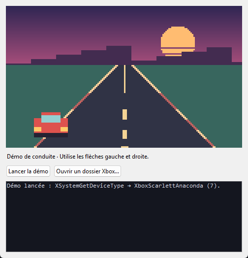

# AnyXboxX — emulatore Xbox Series X (prototipo)

[Français](../../README.md) · [English](README.en.md) · [Español](README.es.md) · [Deutsch](README.de.md) · **Italiano** · [Português](README.pt-BR.md) · [日本語](README.ja.md) · [中文](README.zh-CN.md)

AnyXboxX carica eseguibili Xbox GDK (formato PE32+ x86-64) ed esegue il loro codice con Unicorn. Le funzioni di sistema della console sono sostituite da codice Python (emulazione ad alto livello, come WinDurango o Wine). Il programma si presenta come una Xbox Series X: `XSystemGetDeviceType` restituisce `XboxScarlettAnaconda`.



## Avanzamento del progetto

| Fase | Stato |
|---|---|
| Lettura di `MicrosoftGame.Config` (TitleId, identità, eseguibile Scarlett) | ✅ fatto |
| Caricamento PE32+: sezioni e protezioni, rilocazioni, importazioni, esportazioni | ✅ fatto |
| TLS: copia del modello, indice, callback | ✅ fatto |
| TEB e PEB accessibili tramite il registro GS | ✅ fatto |
| Pagina HLE: 158 nomi di funzioni GDK, kernel, CRT e matematiche emulati | ✅ fatto |
| Funzioni sconosciute: `E_NOTIMPL` e voce nel registro invece di un rifiuto | ✅ fatto |
| Costruttori C++ globali (`_initterm`) eseguiti come codice guest | ✅ fatto |
| Rapporto di compatibilità (`--rapport`) e banco di prova (`--banc`) | ✅ fatto |
| Più moduli collegati nella stessa macchina: DLL del pacchetto, ordinali, reindirizzamenti, rilocazione in caso di conflitto | ✅ fatto |
| `GetModuleHandle`, `GetProcAddress`, `LoadLibrary`, `RtlPcToFileHeader` | ✅ fatto |
| 16/16 DLL di un pacchetto Scarlett inizializzate con le loro dipendenze, 0 chiamate non emulate | ✅ fatto |
| Gioco di test libero `SimpleTriangle` compilato: l'avvio C e l'inizializzazione GDK funzionano in AnyXboxX | ✅ fatto |
| Esecuzione nativa in stile Wine (`--natif`): **SimpleTriangle viene mostrato**, runtime GDK fornito da AnyXboxX | ✅ fatto |
| 79 test automatizzati, 83 % di copertura | ✅ fatto |
| Traduzione di D3D12.X (`d3d12_xs.dll`) e `kernelx.dll` per i binari console | ⏳ da fare |
| Interfacce del runtime GDK dietro `QueryApiImpl` (`XUser`, `XTaskQueue`…) | ⏳ da fare |
| Eccezioni SEH x64 (`.pdata`), thread multipli | ⏳ da fare |
| Caricamento dinamico di una DLL durante l'esecuzione (`LoadLibrary` + `DllMain`) | ⏳ da fare |
| Grafica D3D12.X verso Direct3D 12 / Vulkan | ⏳ da fare |
| Audio, controller, salvataggi `XGameSave` | ⏳ da fare |

<table>
<tr>
<td></td>
<td></td>
</tr>
<tr>
<td align="center">La demo risponde alle frecce della tastiera.</td>
<td align="center">Il registro mostra il rapporto di compatibilità.</td>
</tr>
</table>

## Provare la demo

Su Windows, installa Python 3.12 a 64 bit con Tcl/Tk, poi apri PowerShell nella radice del repository.

```powershell
py -3.12 -m venv .venv
.\.venv\Scripts\python.exe -m pip install -r requirements.txt
.\.venv\Scripts\python.exe .\PrototypeScarlett\scarlett.py --demo
```

Il programma dimostrativo compilato è `PrototypeScarlett/demo.pe`; il suo codice sorgente è `PrototypeScarlett/demo.c`.

## Avviare un gioco in modalità nativa

```powershell
.\.venv\Scripts\python.exe .\PrototypeScarlett\scarlett.py --natif <dossier ou fichier .exe> [dossiers de DLL…]
```


AnyXboxX carica l'eseguibile stesso e lo esegue direttamente sul processore, come Wine. Il runtime Xbox (`xgameruntime.dll`) è fornito da AnyXboxX; la finestra e DirectX 12 sono quelli del PC. **Attenzione: in modalità nativa il programma non è isolato.** Riserva questa modalità ai programmi di fiducia; `--rapport` e `--banc` restano isolati in Unicorn. `ANYXBOXX_TRACE=1` mostra le chiamate intercettate. Dettagli: [docs/jeu-de-test.md](../jeu-de-test.md) (in francese).

## Analizzare un programma

```powershell
.\.venv\Scripts\python.exe .\PrototypeScarlett\scarlett.py --rapport <dossier ou fichier .exe>
```

Il banco di prova carica tutti i moduli PE di una cartella e avvia la loro inizializzazione:

```powershell
.\.venv\Scripts\python.exe .\PrototypeScarlett\scarlett.py --banc <dossier>
```


Risultati dettagliati: [docs/avancee.md](../avancee.md) (in francese). Gioco di test libero confrontato con la sua esecuzione nativa: [docs/jeu-de-test.md](../jeu-de-test.md) (in francese). Una cartella di DLL aggiuntiva (per esempio le DLL di Visual C++) può seguire il bersaglio: `--rapport <cible> <dossier>`.

Il rapporto elenca le funzioni importate, la percentuale già emulata e le funzioni mancanti. Nell'interfaccia, il pulsante **Ouvrir un dossier Xbox…** (Apri una cartella Xbox) legge `MicrosoftGame.Config`, mostra questo rapporto e poi avvia il programma; ogni chiamata non emulata compare nel registro.

## Architettura


| Modulo | Ruolo |
|---|---|
| `emu/config.py` | legge il manifesto del pacchetto GDK |
| `emu/loader.py` | carica l'immagine PE e prepara importazioni, esportazioni e TLS |
| `emu/machine.py` | processore Unicorn, stack, heap, TEB/PEB, smistamento delle chiamate |
| `emu/hle/` | funzioni emulate: `gdk.py`, `kernel.py`, `crt.py`, `libm.py`, `guest.py` |
| `emu/report.py` | rapporto di compatibilità |
| `emu/modules.py` | carica le DLL del pacchetto, collega le importazioni, ordina le inizializzazioni |
| `emu/bench.py` | banco di prova su una cartella di moduli |
| `emu/native/` | esecuzione nativa in stile Wine: caricatore, importazioni reali, runtime GDK di AnyXboxX |
| `scarlett.py` | interfaccia Tkinter e riga di comando |

Per aggiungere una funzione, decora un gestore in `emu/hle/`:

```python
@hle("gdk")
def XSystemGetDeviceType(c):
    return XBOX_SERIES_X
```

## Ricerca

- [Architettura hardware della Xbox Series X](../recherche/architecture-xbox-series-x.md) (in francese): CPU Zen 2, GPU RDNA 2, memoria, Velocity Architecture, sicurezza.
- [Emulatori e livelli di compatibilità esistenti](../recherche/etat-de-l-art.md) (in francese): WinDurango, XWine1, Xenia, strumenti XVD.

## Test

```powershell
.\.venv\Scripts\python.exe -m pip install -r requirements-dev.txt
.\.venv\Scripts\python.exe -m pytest
```

## Contribuire

Il ramo `main` è protetto: ogni contributo passa da una pull request revisionata e i test devono passare. I bug e le funzioni da emulare si segnalano nelle issue. Le regole complete sono in [CONTRIBUTING.md](../../CONTRIBUTING.md) (in francese).

## Limiti

AnyXboxX è un prototipo. Non esegue giochi commerciali: richiedono la GPU della console (D3D12.X) e numerosi servizi di sistema, e sono distribuiti in contenitori cifrati le cui chiavi restano nella console. Il progetto non contiene e non accetta alcun contenuto protetto.
