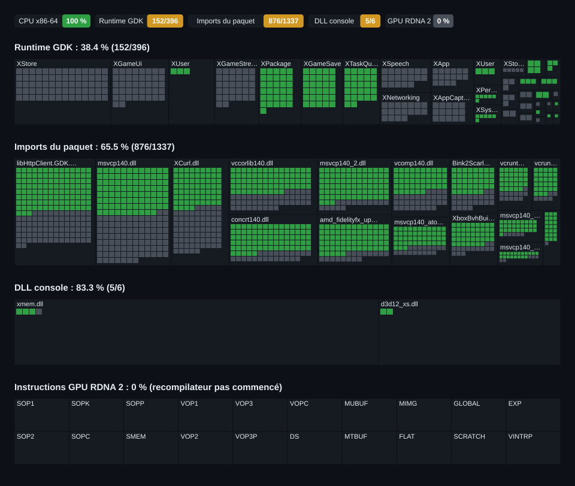
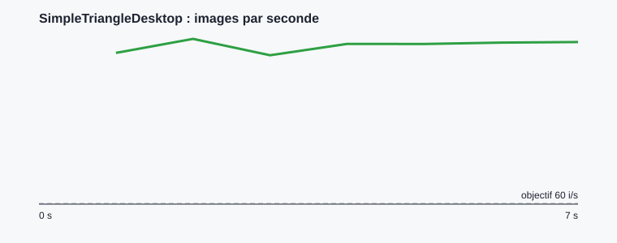
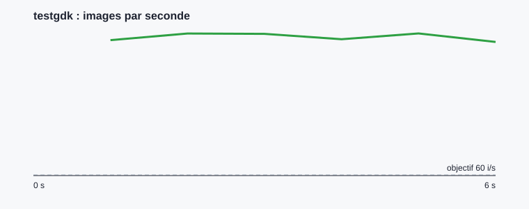

# AnyXboxX — Xbox Series X エミュレーター（プロトタイプ）

[English](../../README.md) · [Français](README.fr.md) · [Español](README.es.md) · [Deutsch](README.de.md) · [Italiano](README.it.md) · [Português](README.pt-BR.md) · **日本語** · [中文](README.zh-CN.md)

AnyXboxX は Xbox GDK の実行ファイル（PE32+ x86-64 形式）を読み込み、そのコードを Unicorn で実行します。コンソールのシステム関数は、ネイティブモードでは C++ ランタイムに、隔離されたマシンでは Python のコードに置き換えられます（WinDurango や Wine と同じ高レベルエミュレーション）。このプログラムは Xbox Series X として振る舞い、`XSystemGetDeviceType` は `XboxScarlettAnaconda` を返します。

## 変換の進捗



再生成：`scarlett.py --carte <パッケージのフォルダー> docs/images/carte-avancee.svg`。


- **プロセッサ命令：100 %。** Series X は x86-64 の AMD Zen 2 を使っており、PC と同じ命令セットです。ネイティブモードでは、ゲームのコードは変換なしでそのまま実行されます。
- **GPU 命令：0 %。** コンソール向けゲームのシェーダーは、Series X の RDNA 2 GPU 向けにコンパイルされています。RDNA 2 → DXIL の再コンパイラーが必要ですが、まだ着手していません。
- **システム関数：66 %。** テスト用パッケージの DLL がインポートする 1 337 個の関数のうち、この割合が隔離モードで解決できています。
- **コンソール固有の DLL**：`xmem.dll`（3/4）と `d3d12_xs.dll`（2/2）は、パッケージが使う関数について変換済みです。D3D12.X のデバイス作成はこれから書く必要があります。
- **GDK ランタイム：396 個の関数のうち 152 個**は AnyXboxX 内に C++ で書かれています。対象はタスクキュー（`XTaskQueue`、`XAsync`、`XThread`）、ユーザー（`XUser`、オフラインのローカルプロファイル）、Xbox Series X の識別情報（`XSystem`、Title ID、アナリティクス、ランタイムの機能）、セーブデータ（`XGameSave`、`XGameSaveFiles`、`XPersistentLocalStorage`）、そしてゲームパッケージ（`XPackage`）です。これらは AnyXboxX がランタイムを単独で管理するとき（Gaming Services がない場合、または `ANYXBOXX_SYSTEM_RUNTIME=0` を指定した場合）に使われます。Windows の GDK ランタイムがある場合は、その API が自前のキューしか受け付けないため、タスクキューを含むすべてのインターフェースをそちらが提供します。トレース（`ANYXBOXX_TRACE=1`）は、要求された各インターフェースの名前を出力します。

グラフは `scarlett.py --traduction <パッケージのフォルダー> docs/images/traduction.svg` で再生成されます。

## パフォーマンス（目標：常に毎秒 60 フレーム）

```powershell
.\.venv\Scripts\python.exe .\PrototypeScarlett\scarlett.py --banc-perf <jeu.exe> [secondes] [courbe.svg]
.\.venv\Scripts\python.exe .\PrototypeScarlett\scarlett.py --natif <jeu.exe> --fps
```

C++ ランタイムは、ゲームの DXGI スワップチェーンの `Present` を 1 回ごとに計測します。DXGI がゲームの DLL（SDL3）によって動的に読み込まれる場合も同様です。ここから、毎秒のフレーム数、1 フレームの平均時間、そして「1% ロー」（最も遅い 1% のフレームの速度で、カクつきが分かります）を求めます。`--fps` はこれらの値をウィンドウのタイトルに表示します。`--banc-perf` は N 秒間計測し（最初の 1 秒は読み込みなので除きます）、「60 fps を維持」の判定を出します（目標に届かなければ終了コードは 2）。これらのオプションを付けなければ、何も横取りしません。





2 つのテストゲームは垂直同期なしで動作し、ネイティブモードで SimpleTriangle は約 11,700 fps、testgdk は約 12,600 fps です。

## プロジェクトの進捗

| ステップ | 状態 |
|---|---|
| `MicrosoftGame.Config` の読み取り（TitleId、ID、Scarlett 実行ファイル） | ✅ 完了 |
| PE32+ の読み込み：セクションと保護属性、リロケーション、インポート、エクスポート | ✅ 完了 |
| TLS：テンプレートのコピー、インデックス、コールバック | ✅ 完了 |
| GS レジスタ経由で TEB と PEB にアクセス可能 | ✅ 完了 |
| HLE ページ：GDK、カーネル、CRT、数学関数の 158 個の関数名をエミュレート | ✅ 完了 |
| 未知の関数：拒否せず `E_NOTIMPL` を返しログに記録 | ✅ 完了 |
| グローバル C++ コンストラクター（`_initterm`）をゲストコードで実行 | ✅ 完了 |
| 互換性レポート（`--rapport`）とテストベンチ（`--banc`） | ✅ 完了 |
| リンクされた複数のモジュールを同一のマシンで実行：パッケージの DLL、序数、フォワーダー、競合時のリロケーション | ✅ 完了 |
| `GetModuleHandle`、`GetProcAddress`、`LoadLibrary`、`RtlPcToFileHeader` | ✅ 完了 |
| Scarlett パッケージの 16/16 個の DLL を依存関係ごと初期化、未エミュレートの呼び出しは 0 件 | ✅ 完了 |
| フリーのテストゲーム `SimpleTriangle` をコンパイル：C のスタートアップと GDK の初期化が AnyXboxX で通る | ✅ 完了 |
| Wine 方式のネイティブ実行（`--natif`）：**SimpleTriangle が表示される**、GDK ランタイムは AnyXboxX が提供 | ✅ 完了 |
| 2 つ目の自由なテストゲーム、SDL3 の `testgdk`：**ネイティブモードで動作**（ウィンドウ、スプライト、サウンド） | ✅ 完了 |
| パッケージまたは exe の隔離起動（`--lancer`）とエミュレートすべき呼び出しの一覧 | ✅ 完了 |
| C++ ランタイム（`runtime/`）：`xgameruntime.dll`、`xmem.dll`、`d3d12_xs.dll` をネイティブモードで事前に読み込み、ゲームのすべての DLL に提供 | ✅ 完了 |
| `xmem.dll`：`XMemAlloc`、`XMemFree`、フック、`XMemVirtualQuery` | ✅ 完了 |
| `d3d12_xs.dll`：ルートシグネチャのシリアライズ。PC の D3D12 にリダイレクト | ✅ 完了 |
| 396 個の GDK 関数の表：インターフェースとメソッド番号を `xgameruntime.lib` から抽出（`tools/gdk_interfaces.py`） | ✅ 完了 |
| `XTaskQueue`、`XAsync`、`XThread` を AnyXboxX が提供：testgdk が Windows のランタイムなしで動作 | ✅ 完了 |
| その他の GDK のインターフェース：Windows の GDK ランタイムに委譲し、トレースで名前を表示 | 🟡 進行中 |
| 188 件の自動テスト | ✅ 完了 |
| D3D12.X：`D3D12XboxCreateDevice` とコンソールの `ID3D12*` インターフェース | ⏳ 未着手 |
| オフラインの `XUser`：常にサインイン済みのローカルプロファイル、変更可能なゲーマータグ（`ANYXBOXX_GAMERTAG`）、testgdk のサインイン成功 | ✅ 完了 |
| Xbox Series X の識別情報：コンソールの種類（レジストリ値 `ConsoleMode` を模擬、ゲームの DLL 内でも有効）、`XSystem`、`MicrosoftGame.config` から読み取る Title ID、「Xbox Series X」のアナリティクス | ✅ 完了 |
| 進捗マップ：関数ごとに 1 マス（`--carte`） | ✅ 完了 |
| コントローラー（`GameInput`）とオーディオ（`XAudio2`）：コンソールと PC で同じ API、ネイティブモードでは Windows の DLL に接続 | ✅ 完了 |
| DLL ごとの不足インポートとエミュレートされていない呼び出しの Markdown レポート（`--lancer … --md rapport.md`） | ✅ 完了 |
| フレームカウンター（`--fps`）と「60 fps 一定」の判定と曲線付きの性能ベンチ（`--banc-perf`） | ✅ 完了 |
| `XGameSave` によるセーブデータ（コンテナー、BLOB、容量制限、非同期読み取り）と永続的なローカルストレージ。保存先は PC のディスク（`%LOCALAPPDATA%\AnyXboxX\<TitleId>`、または `ANYXBOXX_SAVE_DIR`） | ✅ 完了 |
| `XPackage`：ローカルにインストールされたパッケージ（識別子、言語、準備済みのチャンク、ゲームのフォルダーへのマウント） | ✅ 完了 |
| `kernelx.dll`（コンソールのカーネル）: 2,661 個の関数を Windows の `kernel32`/`kernelbase` へ転送 | ✅ 完了 |
| ネイティブモードでのゲームの暗黙的 TLS（`thread_local`）：キャリア DLL `anyxboxx_tls.dll` により各スレッドが自分のコピーを持つ（最大 256 KiB） | ✅ 完了 |
| Python なしの C++ ネイティブランチャー（`runtime/build/bin/anyxboxx.exe <game.exe \| フォルダー> [--fps]`）：SimpleTriangle と testgdk が約 12,000 fps | ✅ 完了 |
| RDNA 2 GPU 逆アセンブラー：1,384 個のニーモニックと LLVM 構文のオペランド（スカラー、VOP1/VOP2/VOPC）、LLVM の公開エンコーディング 29,527 件で検証：`scarlett.py --rdna2 <shader.bin> [--liste]` | 🟡 進行中 |
| AnyXboxX が自前で書くその他の GDK のインターフェース（`XStore`、`XGameUi`、`XNetworking`…） | ⏳ 未着手 |
| RDNA 2 → DXIL のシェーダー再コンパイラー | ⏳ 未着手 |
| x64 SEH 例外（`.pdata`）、マルチスレッド | ⏳ 未着手 |
| 実行中の DLL の動的読み込み（`LoadLibrary` + `DllMain`） | ⏳ 未着手 |
| D3D12.X から Direct3D 12 / Vulkan へのグラフィックス変換 | ⏳ 未着手 |
| コンソールの XMA オーディオデコード（それ以外のオーディオは XAudio2 経由） | ⏳ 未着手 |

<table>
<tr>
<td></td>
<td></td>
</tr>
<tr>
<td align="center">デモはキーボードの矢印キーに反応します。</td>
<td align="center">ログに互換性レポートが表示されます。</td>
</tr>
</table>

## デモを試す

Windows で、Tcl/Tk 付きの 64 ビット版 Python 3.12 をインストールし、リポジトリのルートで PowerShell を開きます。

```powershell
py -3.12 -m venv .venv
.\.venv\Scripts\python.exe -m pip install -r requirements.txt
.\.venv\Scripts\python.exe .\PrototypeScarlett\scarlett.py --demo
```

ネイティブモードには C++ ランタイムが必要です。Visual Studio 2022 または 2026（C++ ワークロード）と CMake でビルドします。

```powershell
cmake -S runtime -B runtime/build -A x64
cmake --build runtime/build --config Release
```

タスクキューは [libHttpClient](https://github.com/microsoft/libHttpClient) の `Task` モジュールを流用しています（MIT ライセンス、`runtime/third_party/libhttpclient-task`）。DLL は `runtime/build/bin`、または `ANYXBOXX_RUNTIME` で指定したフォルダーに出力されます。`ANYXBOXX_SYSTEM_RUNTIME=0` を指定すると、Windows の GDK ランタイムへの委譲が無効になります。

コンパイル済みのデモプログラムは `PrototypeScarlett/demo.pe` で、ソースコードは `PrototypeScarlett/demo.c` です。

## ネイティブモードでゲームを起動する

```powershell
.\.venv\Scripts\python.exe .\PrototypeScarlett\scarlett.py --natif <dossier ou fichier .exe> [dossiers de DLL…]
```


AnyXboxX は実行ファイル自体を読み込み、Wine と同じようにプロセッサ上で直接実行します。Xbox ランタイム（`xgameruntime.dll`）は AnyXboxX が提供し、ウィンドウと DirectX 12 は PC のものを使います。**注意：ネイティブモードではプログラムは隔離されません。** このモードは信頼できるプログラムにのみ使ってください。`--rapport` と `--banc` は引き続き Unicorn 内で隔離されます。`ANYXBOXX_TRACE=1` を指定すると、傍受した呼び出しが表示されます。詳細：[docs/jeu-de-test.md](../jeu-de-test.md)（フランス語）。

## パッケージを隔離モードで起動する

```powershell
.\.venv\Scripts\python.exe .\PrototypeScarlett\scarlett.py --lancer <dossier du paquet ou fichier .exe> [dossiers de DLL…]
```

フォルダーを指定すると、AnyXboxX は `MicrosoftGame.Config` を読み、`Scarlett` 用に宣言された実行ファイルを取り出して、隔離されたマシン（Unicorn）で起動します。プログラムが PC に触れることはありません。レポートには、未解決のインポート、続いてエミュレートされていない呼び出しが、多いものから少ないものの順に出力されます。これがエミュレーターを完成させるための作業リストです。実行ファイルが見つからない場合は、メッセージにその名前が表示されます。 `--md rapport.md` を付けると、同じレポートが Markdown で書き出され、不足しているインポートは DLL ごとにまとめられます。

## プログラムを解析する

```powershell
.\.venv\Scripts\python.exe .\PrototypeScarlett\scarlett.py --rapport <dossier ou fichier .exe>
```

テストベンチは、フォルダー内のすべての PE モジュールを読み込み、その初期化を実行します。

```powershell
.\.venv\Scripts\python.exe .\PrototypeScarlett\scarlett.py --banc <dossier>
```


詳細な結果：[docs/avancee.md](../avancee.md)（フランス語）。ネイティブ実行と比較したフリーのテストゲーム：[docs/jeu-de-test.md](../jeu-de-test.md)（フランス語）。追加の DLL フォルダー（例：Visual C++ の DLL）をターゲットの後ろに指定できます：`--rapport <cible> <dossier>`。

レポートには、インポートされた関数、すでにエミュレートされている割合、不足している関数が一覧表示されます。インターフェースでは、**Open an Xbox folder…**（Xbox フォルダーを開く）ボタンが `MicrosoftGame.Config` を読み取り、このレポートを表示してからプログラムを起動します。エミュレートされていない呼び出しはすべてログに表示されます。

## アーキテクチャ


| モジュール | 役割 |
|---|---|
| `emu/config.py` | GDK パッケージのマニフェストを読み取る |
| `emu/loader.py` | PE イメージを読み込み、インポート、エクスポート、TLS を準備する |
| `emu/machine.py` | Unicorn プロセッサ、スタック、ヒープ、TEB/PEB、呼び出しの振り分け |
| `emu/hle/` | エミュレートされた関数：`gdk.py`、`kernel.py`、`crt.py`、`libm.py`、`guest.py` |
| `emu/report.py` | 互換性レポート |
| `emu/modules.py` | パッケージの DLL を読み込み、インポートをリンクし、初期化の順序を決める |
| `emu/bench.py` | モジュールのフォルダーに対するテストベンチ |
| `emu/native/` | Wine 方式のネイティブ実行：ローダー、実際のインポート、AnyXboxX の GDK ランタイム |
| `scarlett.py` | Tkinter インターフェースとコマンドライン |

関数を追加するには、`emu/hle/` のハンドラーにデコレーターを付けます。

```python
@hle("gdk")
def XSystemGetDeviceType(c):
    return XBOX_SERIES_X
```

## 調査

- [Xbox Series X のハードウェアアーキテクチャ](../recherche/architecture-xbox-series-x.md)（フランス語）：Zen 2 CPU、RDNA 2 GPU、メモリ、Velocity Architecture、セキュリティ。
- [既存のエミュレーターと互換レイヤー](../recherche/etat-de-l-art.md)（フランス語）：WinDurango、XWine1、Xenia、XVD ツール。
- [調査対象の Scarlett パッケージのリバースエンジニアリングノート](../recherche/paquet/README.md)（フランス語、Codex 作成）：RDS5/ETPF テーブル、RPF ヘッダー、パッケージ構成。

## テスト

```powershell
.\.venv\Scripts\python.exe -m pip install -r requirements-dev.txt
.\.venv\Scripts\python.exe -m pytest
```

## コントリビュート

`main` ブランチは保護されています。すべての貢献はレビューされるプルリクエストを経由し、テストに合格する必要があります。バグやエミュレートすべき関数は issue で報告してください。詳しいルールは [CONTRIBUTING.md](../../CONTRIBUTING.md)（フランス語）にあります。
