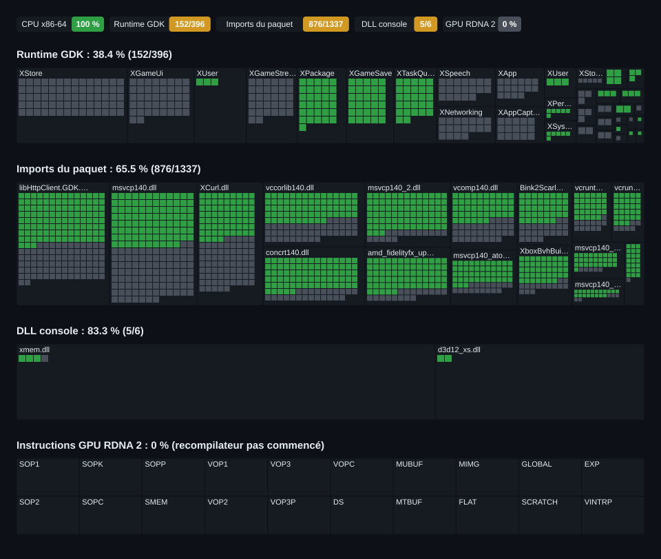
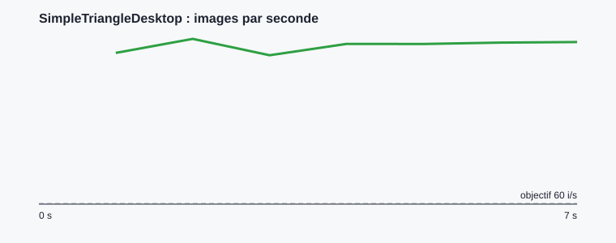
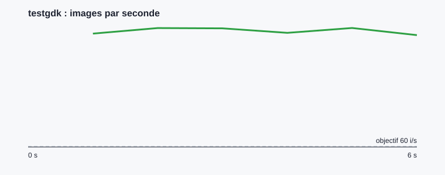
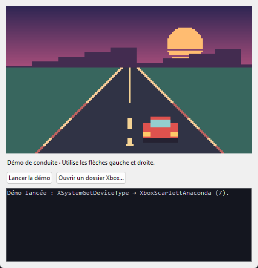

# AnyXboxX — Xbox Series X 模拟器（原型）

[Français](../../README.md) · [English](README.en.md) · [Español](README.es.md) · [Deutsch](README.de.md) · [Italiano](README.it.md) · [Português](README.pt-BR.md) · [日本語](README.ja.md) · **中文**

AnyXboxX 加载 Xbox GDK 可执行文件（PE32+ x86-64 格式），并用 Unicorn 执行其代码。主机的系统函数在原生模式下由 C++ 运行时替代，在隔离的虚拟机中由 Python 代码替代（高级别模拟，与 WinDurango 或 Wine 类似）。该程序会表现为一台 Xbox Series X：`XSystemGetDeviceType` 返回 `XboxScarlettAnaconda`。


## 翻译进展



重新生成：`scarlett.py --carte <包文件夹> docs/images/carte-avancee.svg`。


- **处理器指令：100%。** Series X 使用 x86-64 的 AMD Zen 2，与 PC 的指令集相同：在原生模式下，游戏代码无需翻译，直接原样运行。
- **GPU 指令：0%。** 主机游戏的着色器是针对 Series X 的 RDNA 2 GPU 编译的。需要一个 RDNA 2 → DXIL 重编译器，目前尚未开始。
- **系统函数：66%。** 测试包中各 DLL 导入的 1 337 个函数里，有这个比例在隔离模式下已被解析。
- **主机专用 DLL**：`xmem.dll`（3/4）和 `d3d12_xs.dll`（2/2）已针对该包用到的函数完成翻译。D3D12.X 设备的创建仍待编写。
- **GDK 运行时：396 个函数中的 152 个**是在 AnyXboxX 中用 C++ 编写的：任务队列（`XTaskQueue`、`XAsync`、`XThread`）、用户（`XUser`，一个离线的本地档案）、Xbox Series X 的身份（`XSystem`、Title ID、分析数据、运行时功能）、存档（`XGameSave`、`XGameSaveFiles`、`XPersistentLocalStorage`）和游戏包（`XPackage`）。当 AnyXboxX 单独管理运行时（没有 Gaming Services，或使用 `ANYXBOXX_SYSTEM_RUNTIME=0`）时，它们才会生效。如果存在 Windows 的 GDK 运行时，则由它提供所有接口（包括任务队列），因为其 API 只接受它自己的队列。跟踪（`ANYXBOXX_TRACE=1`）会列出每个被请求接口的名称。

该图表由 `scarlett.py --traduction <包文件夹> docs/images/traduction.svg` 重新生成。

## 性能（目标：稳定 60 帧/秒）

```powershell
.\.venv\Scripts\python.exe .\PrototypeScarlett\scarlett.py --banc-perf <jeu.exe> [secondes] [courbe.svg]
.\.venv\Scripts\python.exe .\PrototypeScarlett\scarlett.py --natif <jeu.exe> --fps
```

C++ 运行时会为游戏 DXGI 交换链的每次 `Present` 计时，即使 DXGI 是由游戏的某个 DLL（SDL3）动态加载的也一样。它由此得出每秒帧数、单帧平均耗时和“1% 低值”（最慢的 1% 帧的速率，可以反映卡顿）。`--fps` 会把这些数值显示在窗口标题中。`--banc-perf` 测量 N 秒，不计入第一秒（加载），并给出“稳定 60 帧/秒”的结论（未达标时返回码为 2）。不使用这些选项时，不会拦截任何内容。





两个测试游戏都在关闭垂直同步的情况下运行：原生模式下，SimpleTriangle 约 11,700 帧/秒，testgdk 约 12,600 帧/秒。

## 项目进展

| 步骤 | 状态 |
|---|---|
| 读取 `MicrosoftGame.Config`（TitleId、标识、Scarlett 可执行文件） | ✅ 已完成 |
| PE32+ 加载：节与保护属性、重定位、导入、导出 | ✅ 已完成 |
| TLS：模板复制、索引、回调 | ✅ 已完成 |
| 可通过 GS 寄存器访问 TEB 和 PEB | ✅ 已完成 |
| HLE 页：模拟了 158 个 GDK、内核、CRT 和数学函数名 | ✅ 已完成 |
| 未知函数：返回 `E_NOTIMPL` 并写入日志，而不是拒绝 | ✅ 已完成 |
| 全局 C++ 构造函数（`_initterm`）以客体代码方式运行 | ✅ 已完成 |
| 兼容性报告（`--rapport`）和测试台（`--banc`） | ✅ 已完成 |
| 在同一台机器中运行多个相互链接的模块：包中的 DLL、序号、转发、冲突时重定位 | ✅ 已完成 |
| `GetModuleHandle`、`GetProcAddress`、`LoadLibrary`、`RtlPcToFileHeader` | ✅ 已完成 |
| Scarlett 包中的 16/16 个 DLL 连同依赖项完成初始化，0 个未模拟的调用 | ✅ 已完成 |
| 已编译免费测试游戏 `SimpleTriangle`：C 启动代码和 GDK 初始化可在 AnyXboxX 中通过 | ✅ 已完成 |
| Wine 式原生执行（`--natif`）：**SimpleTriangle 成功显示**，GDK 运行时由 AnyXboxX 提供 | ✅ 已完成 |
| 第二个自由测试游戏，SDL3 的 `testgdk`：**以原生模式运行**（窗口、精灵、声音） | ✅ 已完成 |
| 隔离启动游戏包或 exe（`--lancer`），并给出需要模拟的调用列表 | ✅ 已完成 |
| C++ 运行时（`runtime/`）：`xgameruntime.dll`、`xmem.dll`、`d3d12_xs.dll` 在原生模式下预先加载，并提供给游戏的所有 DLL | ✅ 已完成 |
| `xmem.dll`：`XMemAlloc`、`XMemFree`、钩子、`XMemVirtualQuery` | ✅ 已完成 |
| `d3d12_xs.dll`：根签名序列化，重定向到电脑的 D3D12 | ✅ 已完成 |
| 396 个 GDK 函数的表：接口和方法编号，提取自 `xgameruntime.lib`（`tools/gdk_interfaces.py`） | ✅ 已完成 |
| `XTaskQueue`、`XAsync`、`XThread` 由 AnyXboxX 提供：testgdk 无需 Windows 的运行时即可运行 | ✅ 已完成 |
| 其他 GDK 接口：委托给 Windows 的 GDK 运行时，由跟踪列出名称 | 🟡 进行中 |
| 164 个自动化测试 | ✅ 已完成 |
| D3D12.X：`D3D12XboxCreateDevice` 和主机的 `ID3D12*` 接口 | ⏳ 待完成 |
| 离线 `XUser`：始终已登录的本地档案、可设置的游戏玩家标签（`ANYXBOXX_GAMERTAG`）、testgdk 登录成功 | ✅ 已完成 |
| Xbox Series X 的身份：主机类型（模拟注册表值 `ConsoleMode`，游戏的 DLL 内同样有效）、`XSystem`、从 `MicrosoftGame.config` 读取的 Title ID、“Xbox Series X”分析数据 | ✅ 已完成 |
| 进展地图：每个函数一格（`--carte`） | ✅ 已完成 |
| `XGameSave` 存档（容器、blob、配额、异步读取）和持久化本地存储，保存在 PC 的磁盘上（`%LOCALAPPDATA%\AnyXboxX\<TitleId>`，或 `ANYXBOXX_SAVE_DIR`） | ✅ 已完成 |
| `XPackage`：本地安装的包（标识符、语言、已就绪的数据块、挂载到游戏文件夹） | ✅ 已完成 |
| 由 AnyXboxX 自行编写的其他 GDK 接口（`XStore`、`XGameUi`、`XNetworking`…） | ⏳ 待完成 |
| RDNA 2 → DXIL 着色器重编译器 | ⏳ 待完成 |
| x64 SEH 异常（`.pdata`）、多线程 | ⏳ 待完成 |
| 在运行时动态加载 DLL（`LoadLibrary` + `DllMain`） | ⏳ 待完成 |
| 将 D3D12.X 图形转换为 Direct3D 12 / Vulkan | ⏳ 待完成 |
| 主机的 XMA 音频解码（其余音频通过 XAudio2） | ⏳ 待完成 |

<table>
<tr>
<td></td>
<td></td>
</tr>
<tr>
<td align="center">演示会响应键盘方向键。</td>
<td align="center">日志中显示兼容性报告。</td>
</tr>
</table>

## 试用演示

在 Windows 上，安装带有 Tcl/Tk 的 64 位 Python 3.12，然后在仓库根目录打开 PowerShell。

```powershell
py -3.12 -m venv .venv
.\.venv\Scripts\python.exe -m pip install -r requirements.txt
.\.venv\Scripts\python.exe .\PrototypeScarlett\scarlett.py --demo
```

原生模式需要 C++ 运行时。可使用 Visual Studio 2022 或 2026（C++ 工作负载）和 CMake 编译：

```powershell
cmake -S runtime -B runtime/build -A x64
cmake --build runtime/build --config Release
```

任务队列沿用了 [libHttpClient](https://github.com/microsoft/libHttpClient) 的 `Task` 模块（MIT 许可证，`runtime/third_party/libhttpclient-task`）。DLL 会输出到 `runtime/build/bin`，或 `ANYXBOXX_RUNTIME` 指定的文件夹。`ANYXBOXX_SYSTEM_RUNTIME=0` 会关闭对 Windows GDK 运行时的委托。

编译好的演示程序是 `PrototypeScarlett/demo.pe`，其源代码是 `PrototypeScarlett/demo.c`。

## 以原生模式运行游戏

```powershell
.\.venv\Scripts\python.exe .\PrototypeScarlett\scarlett.py --natif <dossier ou fichier .exe> [dossiers de DLL…]
```


AnyXboxX 会加载可执行文件本身，并像 Wine 一样直接在处理器上运行它。Xbox 运行时（`xgameruntime.dll`）由 AnyXboxX 提供；窗口和 DirectX 12 则使用电脑自身的。**注意：在原生模式下，程序没有被隔离。** 请仅对可信的程序使用此模式；`--rapport` 和 `--banc` 仍然在 Unicorn 中隔离运行。`ANYXBOXX_TRACE=1` 会显示被拦截的调用。详情：[docs/jeu-de-test.md](../jeu-de-test.md)（法语）。

## 以隔离模式运行游戏包

```powershell
.\.venv\Scripts\python.exe .\PrototypeScarlett\scarlett.py --lancer <dossier du paquet ou fichier .exe> [dossiers de DLL…]
```

指定文件夹时，AnyXboxX 会读取 `MicrosoftGame.Config`，取出为 `Scarlett` 声明的可执行文件，并在隔离的虚拟机（Unicorn）中运行：程序不会接触电脑。报告先列出未解析的导入，再按出现频率从高到低列出未模拟的调用：这就是补全模拟器的工作清单。如果可执行文件缺失，提示信息会指明它的名称。按 `--md rapport.md` 参数运行时，同一份报告会以 Markdown 写出，缺失的导入按 DLL 分组。

## 分析程序

```powershell
.\.venv\Scripts\python.exe .\PrototypeScarlett\scarlett.py --rapport <dossier ou fichier .exe>
```

测试台会加载文件夹中的所有 PE 模块并运行它们的初始化：

```powershell
.\.venv\Scripts\python.exe .\PrototypeScarlett\scarlett.py --banc <dossier>
```


详细结果：[docs/avancee.md](../avancee.md)（法语）。与原生运行结果对比的免费测试游戏：[docs/jeu-de-test.md](../jeu-de-test.md)（法语）。目标之后可以再跟一个额外的 DLL 文件夹（例如 Visual C++ 的 DLL）：`--rapport <cible> <dossier>`。

报告会列出导入的函数、已模拟的百分比以及缺失的函数。在界面中，**Ouvrir un dossier Xbox…**（打开 Xbox 文件夹）按钮会读取 `MicrosoftGame.Config`，显示该报告，然后启动程序；每个未模拟的调用都会出现在日志中。

## 架构


| 模块 | 作用 |
|---|---|
| `emu/config.py` | 读取 GDK 包的清单 |
| `emu/loader.py` | 加载 PE 映像，并准备导入、导出和 TLS |
| `emu/machine.py` | Unicorn 处理器、栈、堆、TEB/PEB、调用分发 |
| `emu/hle/` | 被模拟的函数：`gdk.py`、`kernel.py`、`crt.py`、`libm.py`、`guest.py` |
| `emu/report.py` | 兼容性报告 |
| `emu/modules.py` | 加载包中的 DLL、链接导入、安排初始化顺序 |
| `emu/bench.py` | 针对模块文件夹的测试台 |
| `emu/native/` | Wine 式原生执行：加载器、真实导入、AnyXboxX 的 GDK 运行时 |
| `scarlett.py` | Tkinter 界面和命令行 |

要添加一个函数，请在 `emu/hle/` 中为处理函数加上装饰器：

```python
@hle("gdk")
def XSystemGetDeviceType(c):
    return XBOX_SERIES_X
```

## 调研

- [Xbox Series X 的硬件架构](../recherche/architecture-xbox-series-x.md)（法语）：Zen 2 CPU、RDNA 2 GPU、内存、Velocity Architecture、安全性。
- [现有的模拟器和兼容层](../recherche/etat-de-l-art.md)（法语）：WinDurango、XWine1、Xenia、XVD 工具。

## 测试

```powershell
.\.venv\Scripts\python.exe -m pip install -r requirements-dev.txt
.\.venv\Scripts\python.exe -m pytest
```

## 参与贡献

`main` 分支受到保护：所有贡献都必须经过审阅的 pull request，并且测试必须通过。缺陷和需要模拟的函数请在 issue 中提交。完整规则见 [CONTRIBUTING.md](../../CONTRIBUTING.md)（法语）。

## 局限

AnyXboxX 只是一个原型。它不能运行商业游戏：这些游戏需要主机的 GPU（D3D12.X）和大量系统服务，并且以加密容器的形式发行，密钥保留在主机内部。本项目不包含也不接受任何受保护的内容。
