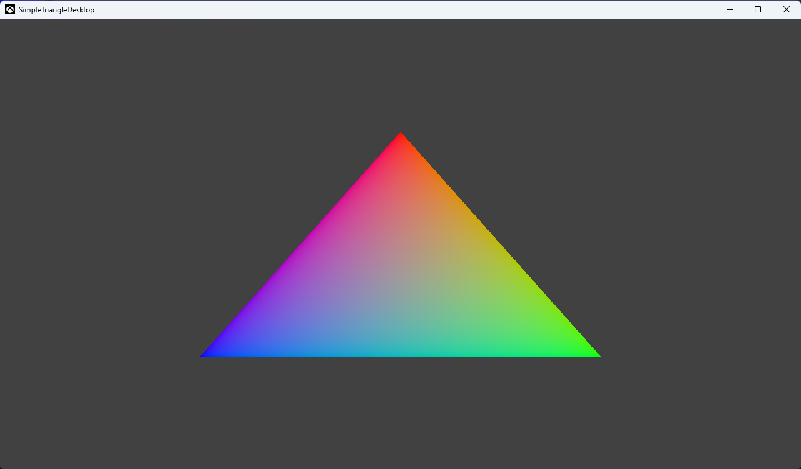
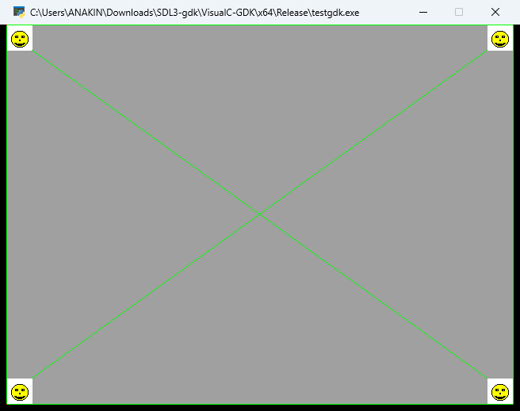

# Jeu de test : SimpleTriangle

Un jeu de test légal qui tourne déjà à 100 % sur PC, pour comparer le comportement natif et celui d'AnyXboxX. Mesures du 21 novembre 2026.

## Pourquoi celui-ci

- **SimpleTriangle** est un échantillon officiel de Microsoft, publié sous licence MIT dans [microsoft/Xbox-GDK-Samples](https://github.com/microsoft/Xbox-GDK-Samples).
- Il existe en deux versions : `SimpleTriangle` pour Xbox Series X|S et `SimpleTriangleDesktop` pour PC. Le code de jeu est le même ; seule la couche plateforme change.
- La version Series X ne se compile qu'avec le GDKX, réservé aux studios sous accord de confidentialité. La version PC se compile avec le [GDK public](https://github.com/microsoft/GDK) : c'est elle qui sert de référence.
- Il est minuscule (une fenêtre, DirectX 12, deux shaders) mais passe par toutes les couches d'un vrai jeu GDK : démarrage C, `xgameruntime.dll`, fenêtre Win32, DirectX 12.

## Référence native



## Dans AnyXboxX, mode natif : le triangle s'affiche


```powershell
python PrototypeScarlett\scarlett.py --natif <...>\x64\Release\SimpleTriangleDesktop.exe
```

AnyXboxX mappe lui-même l'exécutable en mémoire, applique les relocations, déclare sa table d'exceptions (`.pdata`), lie ses imports puis l'exécute directement sur le processeur. C'est l'approche de Wine et de WinDurango.

- **Servi par AnyXboxX** : `xgameruntime.dll`. Le jeu le charge par `LoadLibraryExW`, et AnyXboxX intercepte ce chargement pour fournir son propre runtime GDK (`InitializeApiImplEx2`, `QueryApiImpl`…). Il intercepte aussi `GetModuleHandle`, `GetModuleFileName` et `GetProcAddress`, pour que le jeu se voie lui-même et non `python.exe`.
- **Servi par Windows** : la fenêtre (`USER32`), DirectX 12 (`d3d12`, `dxgi`) et le CRT Visual C++. Pour cette version PC du jeu, ces appels sont déjà ceux du PC. Pour un binaire Series X, il faudra en plus traduire `d3d12_xs.dll` (D3D12.X) et `kernelx.dll`.
- **Sécurité** : en mode natif, le programme n'est pas isolé et a les droits de l'utilisateur. Ce mode est réservé aux programmes de confiance. `--rapport` et `--banc` restent dans Unicorn, isolés.
- **Diagnostic** : `ANYXBOXX_TRACE=1` affiche chaque chargement de DLL, `GetProcAddress` et `QueryApiImpl` intercepté.

## Dans AnyXboxX, mode isolé (Unicorn)

| Étape du jeu | État |
|---|---|
| Chargement : exécutable + `libHttpClient`, `vcruntime140`, `vcruntime140_1`, `msvcp140` liés | ✅ |
| Démarrage C (`_initterm`, `argv`, locale, `_errno`…) puis entrée dans `WinMain` | ✅ |
| Chargement de `xgameruntime.dll` et `InitializeApiImplEx2` (initialisation GDK) | ✅ |
| Création de la fenêtre (`RegisterClassExW`, `CreateWindowExW`, boucle de messages) | ❌ non émulée en mode isolé |
| Création du périphérique DirectX 12 (`CreateDXGIFactory2`, `D3D12CreateDevice`…) | ❌ non émulée en mode isolé |
| Affichage du triangle | ✅ en mode natif, ❌ en mode isolé |

Le mode isolé sert à l'analyse sans risque. Y relier DirectX 12 demanderait de recopier chaque structure entre la mémoire émulée et le PC ; le mode natif évite ce travail.

Fonctions importées : 202, dont **157 résolues (77,7 %)** : 75 émulées en Python et 82 fournies par les DLL Visual C++. Les 45 restantes sont surtout `USER32` (fenêtre, souris, messages), `d3d12`, `dxgi` et les fichiers du CRT.

## Ce que le test a appris

1. **Sur PC, le GDK passe par une interface interne.** Le jeu ne lie pas `XGameRuntimeInitialize` directement : `xgameruntime.lib` charge `xgameruntime.dll`, puis demande `QueryApiImpl`, `InitializeApiImpl`, `InitializeApiImplEx`, `InitializeApiImplEx2`, `XErrorReport` et `UninitializeApiImpl` par `GetProcAddress`. Chaque API `X*` obtient ensuite une interface par `QueryApiImpl`. AnyXboxX accepte l'initialisation et ne fournit pas encore d'interface.
2. **Les DLL Visual C++ ne sont pas dans le dossier du jeu sur PC**, contrairement à un paquet console. Il faut donner leur dossier à AnyXboxX.
3. **Une fonction absente qui renvoie un pointeur fait planter** à l'adresse `0x80004001`. Le traçage a permis d'émuler chaque fonction dans l'ordre où le jeu en a besoin.

## Reproduire

Prérequis : Visual Studio 2022 ou 2026 avec la charge C++, et le GDK public (`winget install Microsoft.Gaming.GDK`).

```powershell
git clone --filter=blob:none --sparse https://github.com/microsoft/Xbox-GDK-Samples.git
cd Xbox-GDK-Samples
git sparse-checkout set --no-cone /Samples/IntroGraphics/SimpleTriangleDesktop/ /Kits/ATGTK/ /Kits/ATGTelemetry/ /Kits/DirectXTK12/
```

Ensuite :

1. Placer le paquet NuGet `WinPixEventRuntime.1.0.240308001` dans `Samples\packages\`.
2. Lancer `Kits\DirectXTK12\Src\Shaders\CompileShaders.cmd dxil` avec son chemin complet.
3. Compiler `SimpleTriangleDesktop.sln` en `Release|x64`, avec `-p:PlatformToolset=v145` sous VS 2026.

Analyse dans AnyXboxX, avec le dossier des DLL Visual C++ en second argument :

```powershell
python PrototypeScarlett\scarlett.py --rapport <...>\x64\Release\SimpleTriangleDesktop.exe "C:\Program Files\Microsoft Visual Studio\18\Community\VC\Redist\MSVC\<version>\x64\Microsoft.VC145.CRT"
```

## Deuxième jeu de test : `testgdk` de SDL3

Mesures du 21 novembre 2026. `testgdk` est le programme de démonstration GDK de [SDL3](https://github.com/libsdl-org/SDL) (licence zlib) : des sprites, du son, la manette et la connexion `XUser`. Il passe par `SDL3.dll`, qui charge `xgameruntime.dll` lui-même par `LoadLibrary`.



| Mode | Résultat |
|---|---|
| Natif (`--natif`) | ✅ fenêtre, sprites et son. `XUserAddAsync` échoue proprement (`E_NOINTERFACE`) : AnyXboxX ne fournit pas encore l'interface `XUser` derrière `QueryApiImpl`. |
| Isolé (`--lancer`) | Démarrage C et SDL passent ; arrêt sur la fenêtre et le texte (`USER32`, `GDI32`), non émulés en mode isolé. |

Deux corrections ont été nécessaires en mode natif :

1. **Ligne de commande** : le jeu lisait celle de Python (`python scarlett.py --natif …`) et la prenait pour ses arguments. AnyXboxX réécrit sur place les tampons de `GetCommandLineW` et `GetCommandLineA`, que relisent le CRT et toutes les DLL, même celles chargées par Windows.
2. **Dossier courant** : le jeu ouvre `icon.png` en chemin relatif. AnyXboxX se place dans le dossier du jeu avant de le lancer.

En mode isolé, `GetCommandLineW/A`, `CommandLineToArgvW` et `GetEnvironmentStringsW` sont maintenant émulées.

Compilation : `VisualC-GDK` de SDL3 vise encore `Gaming.Desktop.x64`, absente du GDK 2610. Il faut remplacer cette plateforme par `x64` dans les projets, ajouter `_GAMING_DESKTOP` et les dossiers `include`/`lib` du GDK (`windows\include`, `windows\lib\x64`), puis compiler `tests\testgdk\testgdk.vcxproj` en `Release|x64` avec `-p:PlatformToolset=v145` et `-p:SolutionDir=<…>\VisualC-GDK\`.

## Instructions processeur et shaders

- **Processeur** : la Series X utilise un AMD Zen 2 en x86-64, le même jeu d'instructions qu'un PC. Rien n'est à traduire. Seules les extensions AVX/AVX2 manquent dans Unicorn ; l'exécution native les apportera.
- **Shaders** : la version PC utilise des shaders DXIL standard (`VertexShader.cso`, `PixelShader.cso`) que le pilote du PC exécute. Sur console, les shaders seraient livrés compilés pour le GPU RDNA 2 (à vérifier sur un binaire Scarlett légal). Les traduire demanderait un recompilateur RDNA 2 → SPIR-V ou DXIL, comme celui de l'émulateur PS4 libre shadPS4 pour le GPU GCN. AMD publie la documentation du jeu d'instructions RDNA 2.
